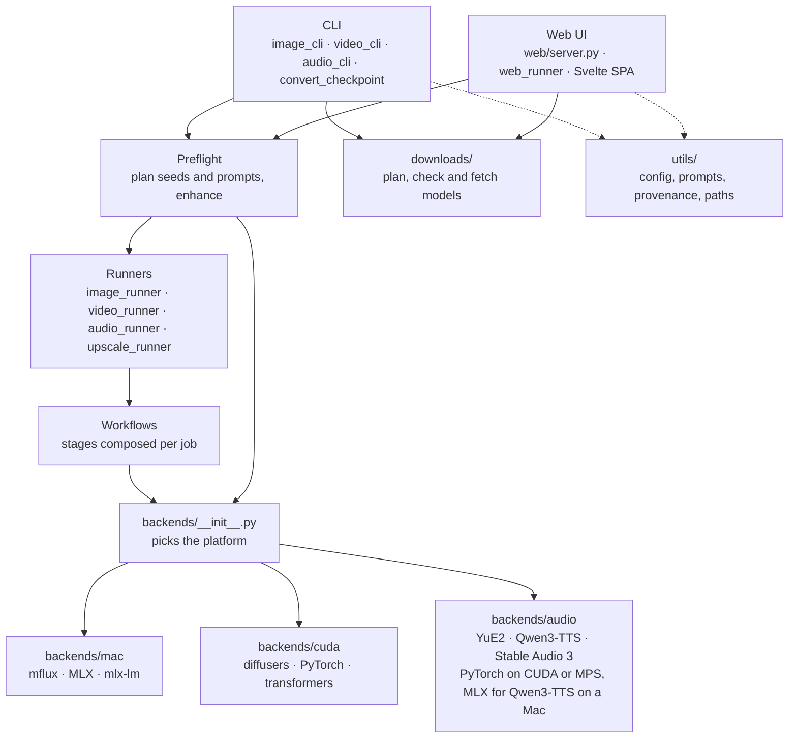

# Architecture

This page is a map of the codebase: where things are, how a job travels through them and what must stay true. It names files but does not list them. A module's own docstring says what it does; every module under `zvisiongenerator/` has one.

## Bird's-eye view

Z-Vision Generator is one Python package, `zvisiongenerator/`, with two front ends over a shared core: the command-line tools and a FastAPI server that serves a Svelte app. Both build the same request objects and hand them to the same runners. Platform-specific code sits behind small protocols, and one module decides which platform's code runs.

The packages, from the top:

| Layer | Where | Knows about the platform? |
|---|---|---|
| Entry points | `image_cli.py`, `video_cli.py`, `audio_cli.py`, `cli.py`, `converters/`, `web/` | No |
| Planning | `preflight.py`, `audio_preflight.py`, `core/job_plan.py` | No |
| Running | `image_runner.py`, `video_runner.py`, `audio_runner.py`, `upscale_runner.py` | No |
| Workflows | `workflows/`, `core/workflow.py` | No |
| Protocols and value types | `core/` | No |
| Selection | `backends/__init__.py` | Yes: the only place |
| Backends | `backends/mac/`, `backends/cuda/`, `backends/matte/` | Yes |
| Audio backends | `backends/audio/` | No: they run on the device `audio_platform_key()` names (`cuda` or `mps`), except `qwen3_tts_mlx`, which runs on MLX |
| Helpers | `utils/`, `processing/`, `schedulers/`, `downloads/` | No |

Code above the backends asks capability questions, such as `supports_video_extend()` or `supports_seedvr2()`, instead of checking the platform; see [the platform rule](#invariants). The frontend lives apart, in `frontend/`, and is built into `zvisiongenerator/web/static/app/`, which is committed.

## Where is X

| Feature | Entry point | Core | Tests |
|---|---|---|---|
| Image generation | `image_cli.py` | `image_runner.py`, `workflows/image_stages.py` | `tests/image/` |
| Video generation | `video_cli.py` | `video_runner.py`, `workflows/video_stages.py` | `tests/video/` |
| Music, speech and sound | `audio_cli.py` | `audio_runner.py`, `backends/audio/` | `tests/audio/`, `tests/backends/test_audio_*.py` |
| Prompt files, `{a\|b}` choices, snippets | `utils/prompts.py` | `utils/prompt_document.py`, `utils/prompt_compose.py` | `tests/prompts/` |
| Prompt enhancer | `enhance_cli.py`, `preflight.py` | `utils/prompt_enhance*.py`, `backends/*/prompt_enhancer.py` | `tests/prompts/` |
| Settings and their precedence | `utils/config.py` | `config.yaml` | `tests/common/test_config.py` |
| Facts about built-in models | `utils/model_metadata.py` | `utils/model_metadata.yaml` | `tests/contracts/test_model_metadata.py`, `tests/common/test_model_metadata.py` |
| Platform and capability selection | `backends/__init__.py` | `core/*_backend.py` protocols | `tests/backends/test_backend_protocol.py` |
| Model downloads | `downloads/ensure.py` | `downloads/plans.py`, `backends/*/download_plan.py` | `tests/downloads/` |
| Memory estimates and fit | `utils/model_memory.py` | `utils/h3_memory.py`, `utils/audio_memory.py` | `tests/common/test_model_memory.py` |
| LoRAs | `utils/lora.py` | `utils/lora_keys.py`, `utils/lora_family.py`, `utils/lora_files.py` | `tests/common/test_lora_*.py` |
| Upscaling | `upscale_runner.py` | `workflows/__init__.py`, `workflows/seedvr2_stages.py`, `seedvr2_loader.py` | `tests/image/test_upscale*.py`, `tests/image/test_seedvr2*.py` |
| Image editing (`--edit`, Edit kind) | `edit_cli.py`, `web/edit_job.py`, `frontend/src/features/workspace/edit/` | `utils/edit_request.py`, `processing/edit_region.py`, `backends/cuda/image/edit.py`, `backends/mac/image_edit.py` | `tests/image/test_edit_*.py`, `tests/web/test_edit_*.py`, `tests/contracts/test_*edit_contract.py` |
| Background removal | `matte_room.py` | `backends/matte/`, `processing/matte.py` | `tests/image/test_matte*.py`, `tests/backends/test_matte_chain.py` |
| Settings saved in outputs, Reuse | `utils/provenance.py` | `web/gallery.py` | `tests/common/test_provenance.py` |
| Web API routes | `web/server.py` | `web/*.py`, one module per concern | `tests/web/` |
| Job queue, events, Stop | `web/web_runner.py` | `web/job_contract.py`, `core/progress_events.py` | `tests/web/test_web_runner.py` |
| Gallery, job log, LoRA index, stars | `utils/app_db.py` | `web/gallery_index.py`, `web/asset_records.py`, `web/job_log.py`, `web/lora_index.py` | `tests/common/test_app_db.py`, `tests/web/test_web_gallery_index.py`, `tests/web/test_web_asset_records.py` |
| A Web UI page | `frontend/src/features/<page>/` | `frontend/src/lib/` | `*.test.ts` beside the source |
| Checkpoint converters | `converters/convert_checkpoint.py` | `converters/*_convert.py` | `tests/converters/` |
| Vendored upstream code | `packages/` | the contract tests | `tests/contracts/` |

## How a job flows

### CLI

1. **Parse.** `image_cli`, `video_cli` or `audio_cli` turns flags into an `argparse` namespace, checks it and resolves the model. Flags are checked here, before anything downloads or loads.
2. **Preflight.** `preflight.run_preflight` plans every iteration (seed, `{a|b}` choice, enhancement) and, when asked, loads the prompt enhancer, rewrites the prompts, closes the enhancer and frees accelerator memory. It returns a frozen `JobPlan`. See [Jobs and workflows](workflows.md#job-phases-preflight-and-generation).
3. **Downloads.** Missing model files are fetched as a step of their own, with progress. See [Model downloads](downloads.md).
4. **Run.** The entry point (`image_cli.py`, `video_cli.py` or, for the Web UI, `web/web_runner.py`) loads the model through the backend and hands it to the runner. The runner has the backend prepare the job's prompts (on macOS this frees the text encoder), then runs the workflow once per iteration of the plan.
5. **Workflow.** A list of stage functions built for the job: resolve the prompt, generate, review, upscale, sharpen, cut out the background, save. See [Workflow stages](workflows.md#workflow-stages).
6. **Save.** `utils/provenance.py` embeds the settings in the PNG, MP4 or FLAC. The Gallery reads them back, and **Reuse settings** loads them.

### Web UI

The same steps, with a different front: the browser posts the Workspace form to `/api/generate`, and `web/server.py` parses it into the same arguments and request objects the CLI builds (`_parse_image_job`, `_parse_video_job`, `_parse_audio_job`). `WebRunner` (`web/web_runner.py`) queues the job and a single worker thread runs it: preflight, downloads, then the same runner functions as the CLI. Progress leaves as events that the browser follows. The CLI and the Web UI therefore have two places that turn user input into a request, and a setting must be wired into both. See [Web server](web-server.md).

### Audio

Audio skips the workflow step. Before the model loads, the caller downloads its files (`ziv audio` in `audio_cli._download_model`; the Web UI through `WebRunner._ensure_downloads`). With an enhanced prompt, `audio_preflight.run_audio_preflight` runs first: it loads the prompt enhancer, rewrites the one text every take uses, and unloads it before `audio_cli` fetches and loads the audio model. The Web UI has no audio preflight; its Enhance button calls the enhancer on request.

`audio_runner.run_audio_batch` then draws a seed per take, loads the preset's `AudioBackend` once and calls `generate` per take. It owns the backend's lifecycle for every family: the torch flags are restored and accelerator memory is released after the backend closes, also after a failure or a Stop. `utils/audio_save.save_flac` writes each take with its settings. Both front ends build the request through the same checks (`utils/audio_request.py`), so they refuse the same values with the same words. See [Web server](web-server.md#audio-jobs) and [Backends](backends.md#audio).

## Invariants

These hold across the codebase. Where a test enforces one, it is named; where none does, review is the check.

- **Only `backends/__init__.py` branches on the platform to choose code.** Everything else asks a capability function. No test enforces it. Two things are not branching and are fine anywhere: OS-level checks unrelated to backends (drive listings, ffmpeg install hints, terminal handling), and passing `platform_key=sys.platform` into a metadata reader, which selects a fact, not code. Two key schemes exist. Model metadata and the readers' `platform_key` use the values of `sys.platform` that matter, `darwin`, `win32` and `linux`. Audio presets use the accelerator, `cuda` or `mps`, which `audio_platform_key()` returns and which is also the torch device.
- **Model facts live in `utils/model_metadata.yaml` and are never merged with user config.** A user file cannot change a pin, a file list, a size, a capability or a licence. Readers that add a setting to a fact copy at the merge. `tests/conftest.py::_model_metadata_cache_unchanged` fails the run if anything wrote into the cached parse; `tests/contracts/test_model_metadata.py` pins the shape of the data.
- **One model is resident at a time.** The enhancer is gone before the generation model loads, and on macOS an image model's text encoder is freed before the first image. The exception is the background removal chain, which loads beside the image model and steps aside when memory is short (`tests/image/test_matte_room.py`). Preflight's order is pinned by `tests/common/test_preflight.py`.
- **No test loads a real model or reaches the network, ffmpeg or the GPU.** The guards in `tests/conftest.py` fail a test that tries; see [Testing](testing.md).
- **The web layer aims to read capabilities from the metadata, not to branch on a model family.** Capabilities and frame rules are facts read through the metadata's readers. No test enforces it, and some code does branch: `web/model_status.py` (memory estimates per video family), `web/lora_fit.py` (H3 LoRA checks), `web/workspace_api.py` (the LTX version of a video row), `web/upscale_api.py` (the LTX-2.3 check) and the not-downloaded text in `frontend/src/features/models/ModelsPage.svelte`. They are known exceptions; do not copy them, and prefer a capability flag in the family's metadata when you touch one.
- **Every output carries its settings.** Reuse, the Gallery and the job log read them back from the file (`tests/common/test_provenance.py`).
- **The app never deletes its database.** A corrupt `ziv.sqlite3` is moved aside, never removed (`tests/common/test_app_db.py`). See [App database](app-database.md).
- **Hugging Face reads from Discover are anonymous and bounded.** The user's token is never sent (`tests/web/test_web_hub_client.py`).
- **The server answers only its own page.** The request guard rejects DNS-rebound hosts and cross-site requests (`tests/web/test_web_request_guard.py`).
- **Vendored packages are never edited by hand.** Where a package records its upstream commit, a contract test in `tests/contracts/` checks that it agrees with the `Makefile`; the others have no such check. See [Vendored packages](vendored.md).
- **The built Web UI is committed.** `make frontend-static-check` rebuilds it and fails on a difference; `make check` runs it.
- **Every CLI flag and user-facing config key is documented.** `tests/common/test_docs_reference.py` fails on a missing one.

## Config and model facts

Configuration is split in two by who may change it.

- **Settings** are one plain `dict`: the packaged `config.yaml`, deep-merged with the user's `config.yaml` from the data folder by `utils/config.load_config()`. They are what a user may change: sizes, steps, guidance, schedulers, the `settings` of a model, the `ui`. Values resolve as CLI flag, then model preset variant, then model preset family, then global default.
- **Model facts** say what a built-in model is: its pins, files, names, download sizes, memory needs, limits, capabilities, frame rules and licences. They are read straight from the packaged file by `utils/model_metadata.load_model_metadata()`. A model id ties a model's facts to its settings (`audio_model_presets.<id>`). See [Add a built-in model](how-to.md#add-a-built-in-model) and [Configuration](../reference/configuration.md).

## Persistent state

| What | Where | Owner |
|---|---|---|
| Models, LoRAs, stored quantized copies | `~/.ziv/models/`, `~/.ziv/loras/` | `utils/paths.py`, `utils/stored_quant.py` |
| Hugging Face downloads | The Hugging Face cache | `downloads/`, `utils/hf_cache.py` |
| User settings | `~/.ziv/config.yaml` | `utils/config.py`, `web/config_contract.py` |
| Gallery and LoRA index, job log, recent prompts, LoRA sources, stars | `~/.ziv/ziv.sqlite3` | `utils/app_db.py` and the components that use it. See [App database](app-database.md) |
| Presets | `~/.ziv/presets/` | `web/presets.py`. See [Settings presets](web-server.md#settings-presets) |
| Saved voices and voice design candidates | `~/.ziv/voices/`, `~/.ziv/voice-design/` | `utils/voice_library.py`, `utils/voice_candidates.py`. See [Saved voices](web-server.md#saved-voices) |
| Error logs | `~/.ziv/logs/` | `utils/app_log.py` |
| Settings of each output | Inside the PNG, MP4 or FLAC | `utils/provenance.py` |

`ZIV_DATA_DIR` moves everything under `~/.ziv/`. See [Data folder](../reference/data-folder.md).

## Cross-cutting concerns

- **Errors and logs.** Entry points start the error log (`utils/app_log.py`, `ZIV_LOG=off` turns it off); expected failures are built-in exceptions with a message a user can act on, and a failed Web UI job reports one bounded line while the log keeps the whole error.
- **Memory.** `utils/model_memory.py` estimates what a model needs, per platform, for the badges and for refusing a clip that cannot fit. `backends/cuda/memory.py` and `backends/mac/memory.py` own the accelerator's own bookkeeping, and `release_accelerator_memory` is what runs between models. On CUDA, `configure_allocator` sets the allocator options (`expandable_segments`, a garbage-collection threshold and a pinned-memory rounding limit) in `PYTORCH_ALLOC_CONF` before CUDA starts, and keeps what the user set.
- **Progress.** Runners emit named events (`core/progress_events.py`); the CLI prints them as lines and the Web UI forwards them to the browser.
- **Control.** Next, Pause and Quit travel as a `SkipSignal` (`utils/interactive.py`), polled at step boundaries and between models.
- **Provenance.** `utils/provenance.py` is the only writer and reader of the settings embedded in outputs.
- **Subprocesses.** Downloads run in a child process so Stop can end them; ffmpeg runs through `utils/ffmpeg.py`.
