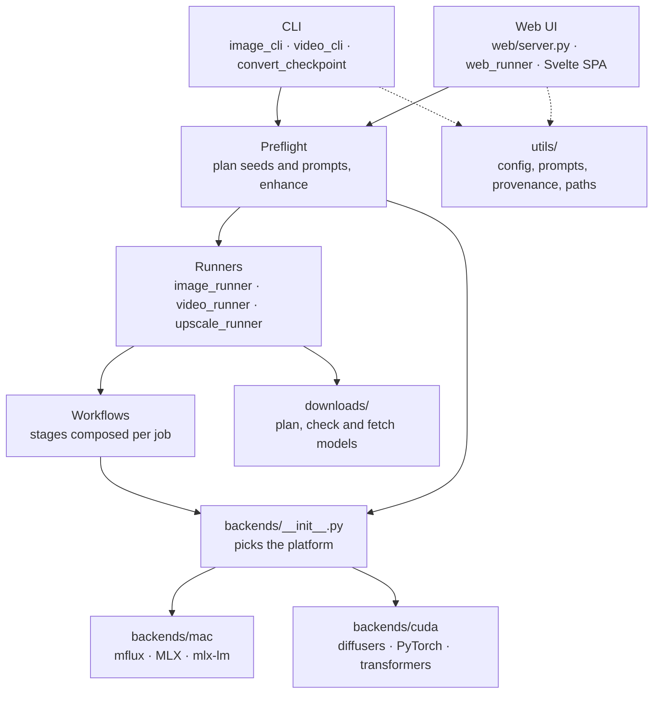

# Architecture overview

Z-Vision Generator is one Python package with two front ends, the CLI and the Web UI, over a shared core. Platform-specific code sits behind small protocols, and only one place decides which platform's code runs.

## A job, start to finish

1. **An entry point** turns flags or a form into arguments: `image_cli` and `video_cli` for the CLI, `web/server.py` for the Web UI, which hands the job to the single worker thread in `web/web_runner.py`.
2. **Preflight** plans every iteration (seed, `{a|b}` choices, enhancement), and, if asked, loads the prompt enhancer, rewrites the prompts and unloads it. It returns a frozen `JobPlan`. See [Jobs and workflows](workflows.md#job-phases-preflight-and-generation).
3. **Downloads** fetch any model files that are missing, as their own step with progress. See [Model downloads](downloads.md).
4. **The runner** loads the model through the backend, lets the backend prepare the job's prompts (`prepare_prompts`; on macOS this encodes them all and frees the text encoder), then runs the workflow once per iteration of the plan.
5. **The workflow** is a list of stage functions built for the job: resolve the prompt, generate, review, upscale, sharpen, save. See [Workflow stages](workflows.md#workflow-stages).
6. **Saving** embeds the settings in the PNG or MP4 (`utils/provenance.py`), which is what the Gallery reads back and **Reuse settings** loads.

Only one model is resident at a time: the enhancer is gone before the generation model loads; on macOS an image model's text encoder is freed before the first image.

## Layers

| Layer | Where | Knows about the platform? |
|---|---|---|
| Entry points | `image_cli.py`, `video_cli.py`, `cli.py`, `converters/`, `web/` | No |
| Planning | `preflight.py`, `core/job_plan.py` | No |
| Running | `image_runner.py`, `video_runner.py`, `upscale_runner.py` | No |
| Workflows | `workflows/`, `core/workflow.py` | No |
| Protocols and value types | `core/` | No |
| Selection | `backends/__init__.py` | Yes: the only place |
| Backends | `backends/mac/`, `backends/cuda/` | Yes |
| Helpers | `utils/`, `processing/`, `schedulers/`, `downloads/` | No |

Code above the backends asks capability questions, such as `supports_video_extend()` or `supports_seedvr2()`, instead of checking the platform. See [Backends](backends.md).

## Config

Config is one plain `dict`: the packaged `config.yaml`, deep-merged with the user's `config.yaml` from the data folder by `utils/config.load_config()`. Values resolve as CLI flag, then model preset variant, then model preset family, then global default. Per-model capabilities, such as `supports_img2img` or `dimension_max`, are config data in `model_presets`, so the web layer never branches on a model family. Video families (LTX and MiniMax H3) are described the same way, with frame rules, steps and capabilities per platform; see [Video families](backends.md#video-families). See [Configuration](../concepts/configuration.md).

## The Web UI

The server is FastAPI. It serves the built Svelte app from `web/static/app/` and a JSON API under `/api/`. Jobs go through one worker thread, in a FIFO queue; Models-page downloads have their own lane beside it. Progress reaches the browser as events. See [Web server](web-server.md) and [Frontend](frontend.md).

## Persistent state

| What | Where | Owner |
|---|---|---|
| Models, LoRAs, stored quants | `~/.ziv/models/`, `~/.ziv/loras/` | `utils/paths.py`, `utils/stored_quant.py` |
| Hugging Face downloads | The Hugging Face cache | `downloads/`, `utils/hf_cache.py` |
| User settings | `~/.ziv/config.yaml` | `utils/config.py`, `web/config_contract.py` |
| Gallery and LoRA index, job log, recent prompts, LoRA sources | `~/.ziv/ziv.sqlite3` | `utils/app_db.py`, `web/gallery_index.py`, `web/lora_index.py`, `web/job_log.py`, `web/recent_prompts.py`, `web/lora_sources.py`. See [App database](app-database.md) |
| Presets | `~/.ziv/presets/` | `web/presets.py`. See [Settings presets](web-server.md#settings-presets) |
| Error logs | `~/.ziv/logs/` | `utils/app_log.py` |
| Settings of each output | Inside the PNG or MP4 | `utils/provenance.py` |
