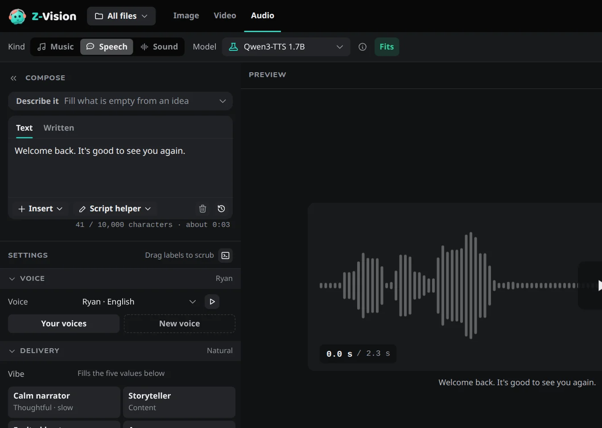

# Your first audio

From a running Web UI to a first take in the **Audio** tab. Start with speech: it needs nothing but a few words.

If the Web UI isn't open yet, run `ziv ui` in a terminal and keep the terminal open; see [Install](install.md). Audio also needs ffmpeg: [step 5 of Install](install.md#ffmpeg).

Takes are saved as FLAC files in the output folder, each with the settings it was made with; see [Output files](../reference/data-folder.md#output-files). Nothing moving for a long time? See [The first job seems stuck](../reference/troubleshooting.md#the-first-job-seems-stuck).

## 1. Pick a kind and a model { #pick-a-kind-and-a-model }

Choose **Audio**, the last tab in the top bar. In the toolbar, set **Kind** to **Speech**. **Model** shows **Qwen3-TTS 1.7B**, the model that reads text aloud. If you haven't downloaded it, **Generate** offers to.



## 2. Write it { #write-it }

Type what should be read in **Text** under *Compose*:

```text
Welcome back. It's good to see you again.
```

Plain text is enough. The line under the box counts the characters and says how long the text takes to read. The voice is **Ryan**, the default, under **Voice** in *Settings*; the other default voices are in [Voices](../guides/speech-and-sound.md#voices).

## 3. Generate and listen { #generate-and-listen }

Press **Generate**, or ++ctrl+enter++ (++cmd+enter++ on a Mac).

When the take is done, its waveform shows in the preview; press the play button to listen. The take is also in the [Gallery](../web-ui/gallery.md#audio), which has an **Audio only** filter, and it's the same file you can give to a video: **Use as** → **Audio track**.

## Next

- Change how it is read: [Make speech and sound](../guides/speech-and-sound.md#delivery).
- Songs and instrumentals: [Make music](../guides/music.md). Ambience and effects: [Sound](../guides/speech-and-sound.md#sound).
- Prefer the terminal? [Make audio from the command line](../cli/audio.md).
