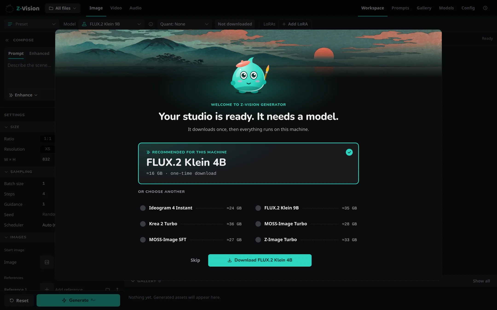
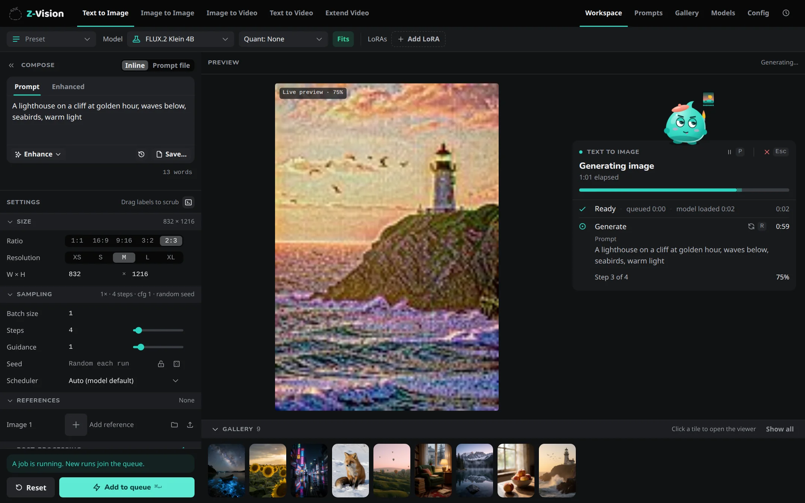

# Your first image

From a running Web UI to a finished picture.

If the Web UI isn't open yet, run `ziv ui` in a terminal and keep the terminal open; see [Install](install.md).

## What happens and how long { #what-happens-and-how-long }

The first image downloads a model and loads it into memory, so it is the slowest; the job card shows each phase. Images are saved in the output folder, `~/.ziv/outputs` unless you [changed it](../web-ui/config.md), each with the settings it was made with. Nothing moving for a long time? See [The first job seems stuck](../reference/troubleshooting.md#the-first-job-seems-stuck).

## 1. Pick a model { #pick-a-model }

The first time, a welcome dialog offers an image model picked for your machine. Press **Download**; it becomes your default image model, and you can write your prompt while it downloads.



## 2. Write a prompt { #write-a-prompt }

Check that **Image** is selected in the top bar. Type what you want to see in the **Prompt** box under *Compose*:

```text
A red fox sitting in fresh snow, early morning light, close-up
```

Plain descriptions work best: the subject, where it is, the light, and how it's framed. Random choices and other tricks are in [Prompt syntax](../concepts/prompt-syntax.md).

**On a phone:** the prompt sits at the bottom of the screen, beside **Generate**. Tap it to type.

## 3. Generate { #generate }

Press **Generate**, or ++ctrl+enter++ (++cmd+enter++ on a Mac).



The job card shows each phase and how long it took. The preview shows the image taking shape after every step; it is only a preview and is never saved.

## 4. Look at the result { #look-at-the-result }

The finished image fills the preview and appears first in the Gallery strip. Click it to open the viewer, with its settings under **Details**; **Reuse settings** (++r++) loads them back into the Workspace. On a phone, tap the preview to open the viewer.

## Next

- Let the model write the details: [Prompt enhancer](../concepts/prompt-enhancer.md).
- Sizes, seeds and more: [Make images](../guides/images.md) and [Get better results](../guides/better-results.md).
- Keep work together in a [project](../concepts/projects.md).
- Prefer the terminal? [Make images from the command line](../cli/images.md).
