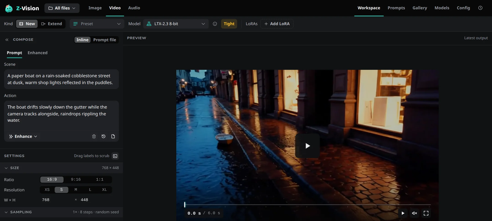

# Your first video

From a running Web UI to a finished clip, with sound.

If the Web UI isn't open yet, run `ziv ui` in a terminal and keep the terminal open; see [Install](install.md).

Clips are saved as `.mp4` files in the output folder, each with the settings it was made with; see [Output files](../reference/data-folder.md#output-files). Nothing moving for a long time? See [The first job seems stuck](../reference/troubleshooting.md#the-first-job-seems-stuck).

## 1. Pick the video model { #pick-the-video-model }

Choose **Video** in the top bar. **Model** at the top of the sidebar shows the video model; if you haven't downloaded it, **Generate** offers to. If **Model** shows **Tight** or **Too large**, pick the smaller **LTX-2.3 4-bit** (`ltx-4`) ([why](../concepts/memory.md#switch-to-the-smaller-model)).

## 2. Describe the scene and the action { #describe-the-scene-and-the-action }

A video prompt has two boxes under *Compose*:

- **Scene**: who and where, the look and the camera setup. It stays the same for the whole clip.
- **Action**: what happens, in order, with camera moves, sounds and any spoken lines in quotes.

```text title="Scene"
A knight in a grey castle courtyard, overcast, handheld camera.
```

```text title="Action"
She draws her sword and turns to the gate. Wind howls over the walls.
```

You can leave **Scene** empty and write everything in **Action**. More on both: [Scene and action](../guides/video.md#scene-and-action).

## 3. Set the length and size { #set-the-length-and-size }

In *Settings*:

- **Duration (s)** is the clip's length. It snaps to a length the model can make and shows the frame count next to it.
- **Resolution** and **Ratio** set the size. `16:9` at `s` (768×448) is the default and quick to try.

## 4. Generate { #generate }

Press **Generate**, or ++ctrl+enter++ (++cmd+enter++ on a Mac). **Cancel**, or ++esc++ twice, stops a video job.

The finished clip plays in the preview and appears first in the Gallery strip below it.



## Next

- Start from a picture: [Image to video](../guides/video.md#start-from-an-image).
- Make a clip longer with **Extend** in the viewer: [Extend a clip](../guides/video.md#extend-a-clip).
- Prefer the terminal? [Make video from the command line](../cli/video.md).
