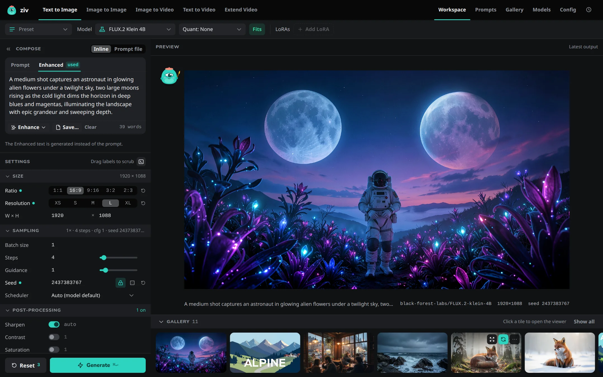

<h1 class="zh__rise">Your own studio for AI images and video.</h1>

Write a prompt, press Generate, and the picture or clip is made on your own computer. No cloud, no node graphs.

<a class="zh__btn zh__btn--primary" href="web-ui/">Start with the Web UI</a><a class="zh__btn" href="cli/">Use the CLI</a>

## What it does

- **Images** from a prompt, with Z-Image, FLUX.2 Klein, Krea 2 Turbo and Ideogram 4 Instant.
- **Videos with sound** from a prompt or a starting image, with LTX-2.3, LTX-2.5 and MiniMax H3. End on a chosen last frame with H3, and extend a clip to make it longer.
- **A prompt enhancer** that runs on your machine and turns a short idea into a detailed prompt.
- **Upscaling** of new and existing images, of video as it's made, and of existing videos on Windows and Linux.
- **Prompt files** with random choices, reusable snippets and batch runs.
- **LoRAs**, stacked and weighted, for images and video.
- **Models that download themselves** on first use, or ahead of time from the Models page, and your own fine-tunes converted with one command.

It runs on macOS with Apple Silicon, and on Windows and Linux with an NVIDIA GPU. The same models and features work on all three.

## Two ways in

-   **Web UI**

    ---

    A browser app for writing prompts, generating, browsing your gallery and managing models. Works from a phone or tablet too.

    [Start with the Web UI](web-ui/index.md){ .md-button .md-button--primary }

-   **Command line**

    ---

    `ziv-image` and `ziv-video` for scripted and batch work, with every setting as a flag.

    [Start with the CLI](cli/index.md){ .md-button }

Both use the same models, prompt files, settings and output folder, so you can switch between them at any time. The Web UI can even copy the command that reproduces its current settings.

## Where to go next

- [Install](install.md): what you need and how to install.
- [Concepts](concepts/index.md): how models, prompts, upscaling and memory work, whichever way you use the app.
- [Troubleshooting](concepts/troubleshooting.md): when something goes wrong.
- [Developer](developer/index.md): working on the code.
