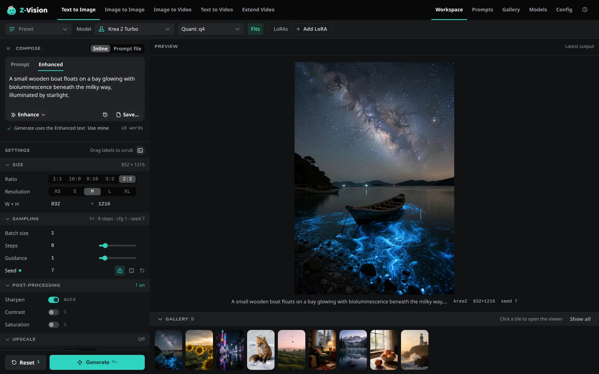

<h1 class="zh__rise">Your own studio for AI images, video and audio.</h1>

Write a prompt, press Generate, and the picture, clip or track is made on your own computer. No cloud, no node graphs.

[Install](get-started/install.md){ .md-button .md-button--primary .zh__btn .zh__btn--primary }
[Already installed? Your first image](get-started/first-image.md){ .md-button .zh__btn }

Prefer the terminal? [Command line](cli/index.md)

## What you can make

-   **Images**

    ---

    Pictures from a prompt, in the shape and style you describe.

    [Make images](guides/images.md)

-   **Video**

    ---

    Clips with sound, from a prompt or a starting image.

    [Make video](guides/video.md)

-   **Audio**

    ---

    Songs, speech in a voice you pick, and sound effects.

    [Make music](guides/music.md) · [Make speech and sound](guides/speech-and-sound.md)

No account or payment needed. Your computer does the work; [open it from your phone or tablet](web-ui/devices.md).

Something not working? See [Troubleshooting](reference/troubleshooting.md).

