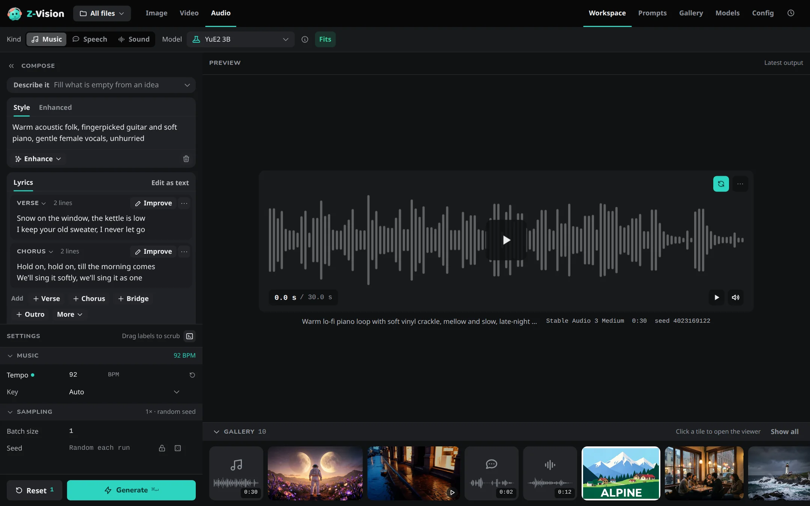
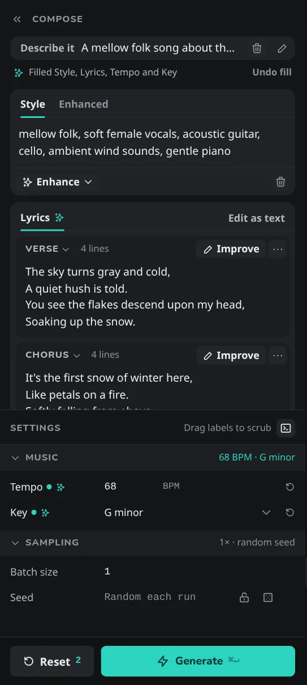
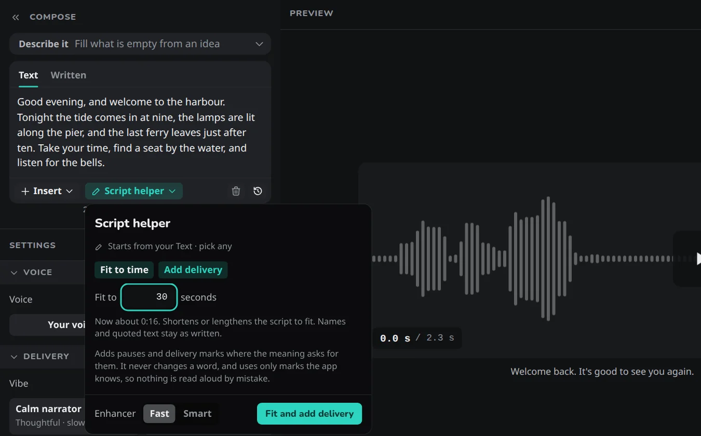
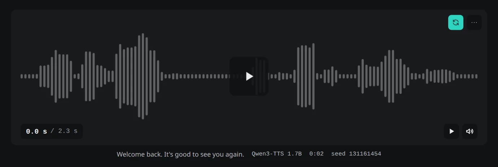

# Audio tab

**Audio** is the last tab in the top bar of the [Workspace](workspace.md). It makes music, speech and sound as FLAC files, on your own computer. The tab is hidden on a machine that can't run an audio model.

**Kind** (**Music**, **Speech** or **Sound**) decides what *Compose* and *Settings* show, and the **Model** menu lists the models for it. Presets, **Quant** and LoRAs aren't used, and there is no JSON caption or negative prompt. What each kind makes, its models and its limits are in [Make music](../guides/music.md) and [Make speech and sound](../guides/speech-and-sound.md).

**On a phone:** see [Audio on a phone](devices.md#audio-on-a-phone).

## Compose

| Kind | Compose | Settings |
|---|---|---|
| **Music** | [**Describe it**](#describe-it), then **Style** (required), with an **Enhanced** tab, above **Lyrics**; a model without lyrics has only the Style | The [Music](#music-settings) section |
| **Speech** | [**Describe it**](#describe-it), then **Text**, with a **Written** tab, **Insert** and a **Script helper** | [**Voice**](#voice) and [**Delivery**](#delivery) |
| **Sound** | **Prompt**, what you hear, with an **Enhanced** tab | The [Sound](#sound-settings) section |

The **Enhanced** and **Written** tabs, their marks, the versions, and **Clear** with its **Undo** work as in [the prompt box](workspace.md#the-prompt-box). For Lyrics, **Clear** empties the whole song and its versions.

Writing the text of each kind is covered in [Write the style and lyrics](../guides/music.md#music), [Write the text](../guides/speech-and-sound.md#speech) and [Make sound effects and ambience](../guides/speech-and-sound.md#sound).

### Describe it

**Describe it** is a box at the top of *Compose* for Music and Speech, shown wherever the prompt enhancer is set up. You write an idea in it and press **Fill in**. Its **Fast** or **Smart** choice is separate from the one in **Enhance** and the helpers. A **✦** marks the Tempo, Key and Vibe it wrote until you edit them, and **Clear** empties the idea only. What it writes and keeps is in [Write it from an idea with Describe it](../guides/music.md#describe-it).

{ width="360" }

### Song blocks

The Lyrics box shows a song as one block per section (**Verse**, **Chorus**, **Pre-Chorus**…). A block's **⋯** menu has **Improve this section…** (or **Write**, on a section with no words) where the prompt enhancer is set up, and **Edit as text** shows the whole lyrics as one text with its `[section]` tags. A song with no words in any block is an instrumental of those sections; see [Make an instrumental](../guides/music.md#make-an-instrumental).

### Lyrics helper

**Improve lyrics** in the Lyrics tools row opens a helper for the whole song; a block's **Improve** (or **Write**) opens it for that section. A result is a version of the lyrics, with a ✦ after **Lyrics** while a version the helper wrote is shown. The helper is offered only for a model that sings lyrics. See [Improve lyrics](../guides/music.md#lyrics-helper).

### Enhance

**Enhance** under the Style (Music) or the Prompt (Sound) rewrites it for the open model, with choices that each start on **Keep**. It never touches Lyrics, and the Music panel offers **Singer** only when the song has words to sing. **Reuse settings**, **Retry** and **Load settings** of an enhanced take put your text in **Style** or **Prompt** and the rewrite in **Enhanced**. What each choice does is in [Polish the style with the enhancer](../guides/music.md#enhance-the-prompt) and, for sound, [Polish the prompt with the enhancer](../guides/speech-and-sound.md#sound).

### Insert and Script helper

**Insert** in the Speech tools row puts a pause, a laugh or a delivery change into the text at the caret, or into the Written text while that tab is shown. See [Insert a pause, a laugh or a delivery](../guides/speech-and-sound.md#pauses-and-laughs).

#### Script helper

**Script helper** in the same row fits the script to a time or adds delivery. A result lands in the **Written** tab beside your **Text**. See [Get help with the script](../guides/speech-and-sound.md#script-helper).

## Settings

The groups of *Settings* follow the kind. **Seed** has the same padlock and dice as on the other tabs; see [Seed](workspace.md#seed). **Batch size** makes that many takes with one model load. **Reset** puts back the tempo, key, delivery, sound type, length, voice, **Enhance** options, **Batch size** and **Seed**, keeping the kind, the models and the text.

### Music { #music-settings }

**Tempo** and **Key** are **Auto** until you set them, and the model picks. **Length (s)** is only there for a model that sets its own length, Stable Audio 3 Medium: 1 to 380 seconds. **Stable Audio 3 Medium** is offered under **Music** next to YuE2 and under **Sound**; on it, Music has no **Lyrics** box. See [Set tempo, key and length](../guides/music.md#tempo-and-key) and [Make music with Stable Audio](../guides/music.md#stable-audio-under-music).

### Sound { #sound-settings }

**Type** is **Auto**, **Ambience**, **Effect** or **One-shot**. **Length (s)** is empty on Auto, and the field shows the number Auto will use; typing a number from 1 to 380 locks it. See [Make sound effects and ambience](../guides/speech-and-sound.md#sound).

### Voice

**Voice** lists **Your voices** above the nine **Default voices**; Ryan is the default. **Your voices** and **New voice** open the **Voices** window, where you design a voice, clone one from a recording and manage saved ones. A recording used for one take only shows as **From recording** in the dropdown. A speech take can also be kept as a voice from the Gallery; see [Use as](gallery.md#use-as-an-audio-track-or-a-voice). Renaming and deleting a saved voice is in [Manage your voices](../guides/speech-and-sound.md#manage-your-voices); using, designing and cloning voices is in [Pick a voice](../guides/speech-and-sound.md#voices).

### Delivery

**Delivery** sets how a default voice says the text: a **Vibe** and rows for **Emotion**, **Manner**, **Pace**, **Pitch** and **Expressiveness**. With a saved voice or a recording chosen in Voice, the section only says that the voice reads as it was made. What each setting does is in [Set the delivery](../guides/speech-and-sound.md#delivery).

## While a take is made

The job card counts takes (*Take 1 of 2*), and **Pause**, **Skip**, **Repeat** and **Cancel** work as for [images](workspace.md#while-a-job-runs).

## The result

The preview shows the finished take as a player whose waveform is the timeline; nothing plays by itself. A take that reached YuE2's limit carries **Cut at 6:00**. Takes appear in the Gallery strip as audio tiles; see [Audio in the Gallery](gallery.md#audio). Where the files are and how to use a take elsewhere is in [Find your takes](../guides/music.md#takes-and-files).
