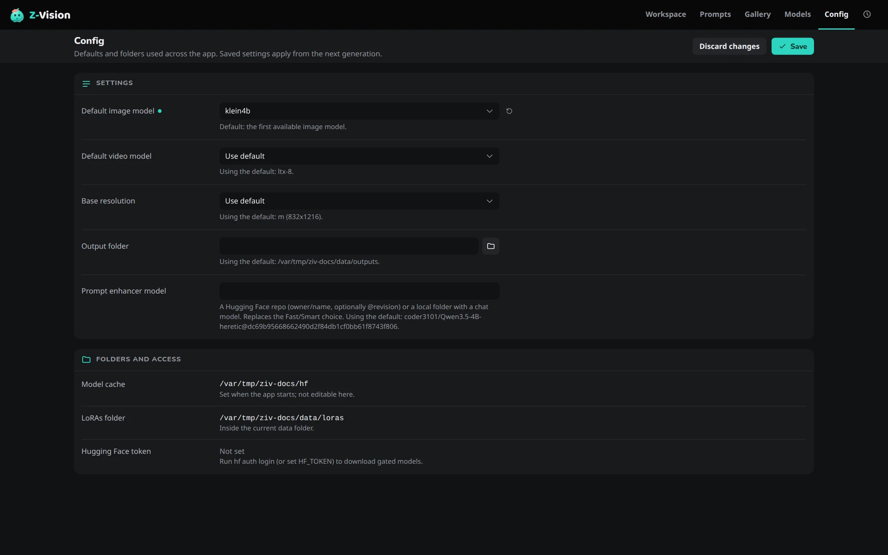

# Config page

The **Config** page (++g++ ++c++) holds the defaults the whole app uses: which models the Workspace starts with, the base image size, where files are saved and which model rewrites your prompts. Saved settings apply from the next generation.

## Settings

| Setting | Sets | When empty |
|---|---|---|
| **Default image model** | The model the Workspace starts with for images | The first available image model |
| **Default video model** | The model the Workspace starts with for video | The first available video model |
| **Base resolution** | The image size preset, such as `m (832x1216)` | The app's base resolution, `m` |
| **Output folder** | Where images, videos and audio are saved. The folders directly under it are your [projects](../concepts/projects.md) | `outputs` in the [data folder](../reference/data-folder.md), which moves with `ZIV_DATA_DIR` |
| **Prompt enhancer model** | A Hugging Face repo (`owner/name`, optionally `@revision`) or a local folder with a chat model, used instead of Fast and Smart | Fast or Smart, chosen in the Enhance popover |

**Use default** in each model and size menu clears the setting.

The settings are saved to `config.yaml` in the data folder, which also holds settings this page doesn't show. Comments in the file are kept. Every setting of the file is in [Configuration](../reference/configuration.md). A file that can't be read is explained in [Troubleshooting](../reference/troubleshooting.md#configuration-file).

## Folders and access

These are shown for reference and can't be changed here:

- **Model cache**: where Hugging Face downloads go, `~/.cache/huggingface/hub` unless `HF_HOME` or `HUGGINGFACE_HUB_CACHE` says otherwise when the app starts.
- **LoRAs folder**: `loras` in the data folder.
- **Hugging Face token**: whether a token was found, and where it comes from. Gated models need it. See [Hugging Face token](../reference/data-folder.md#hugging-face-token).

The [Models page](models.md#folders-and-access) has a panel of its own, with the **Models folder** (`models` in the data folder) in place of the **Model cache**.
