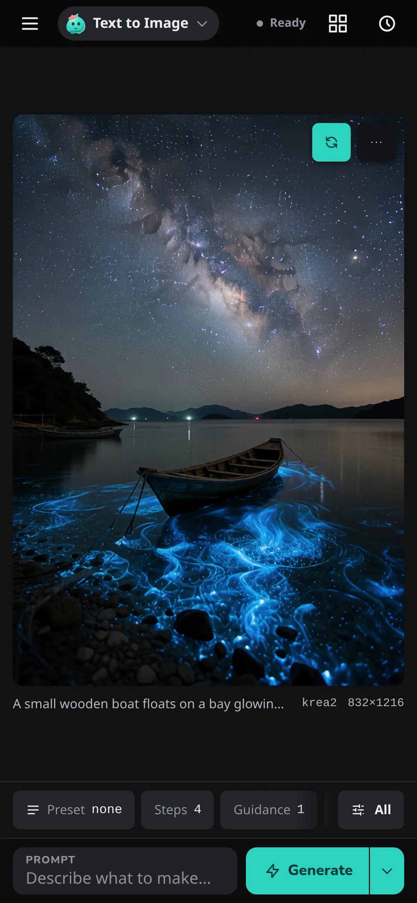

# Phones, tablets and other computers

The Web UI runs on the computer that generates, and you can use it from any browser on your network: a phone on the sofa, an iPad, or a laptop while the desktop does the work.

## Open it from another device

Start the Web UI so other devices can reach it:

```bash
ziv ui --host local
```

It prints this computer's network address, for example `http://192.168.1.20:8080/`. Open that address on the other device.

!!! warning "Your network only"
    `--host local` makes the Web UI reachable by every device on your network, with no login. Anyone who can open it can browse this computer's folders and view and play its pictures, videos and audio. Use it on a network you trust.

The server only answers requests addressed to an IP address, `localhost`, the `--host` value, or this computer's name (bare and with `.local`), and refuses changes requested by other websites. To reach it under another name, list that name in `ZIV_UI_ALLOWED_HOSTS`:

```bash
ZIV_UI_ALLOWED_HOSTS=studio.lan ziv ui --host local
```

## Keep it running

```bash
ziv ui --background
```

starts the Web UI, prints its address and gives you the prompt back. It keeps running after you close the terminal; its output goes to the [error log](../concepts/data-folder.md#error-log).

```bash
ziv ui --background-stop
```

stops every running Web UI, including ones running in another terminal, and any job they are running.

## On a phone

{ width="300" }

On the phone, Share → *Add to Home Screen* installs the Web UI as an app that opens without the browser's bars.

The preview is the screen:

- **Swipe sideways** through earlier outputs, and **swipe up** for the Gallery.
- **Tap** the preview to open the viewer. Pinch or double-tap to zoom.
- **Press and hold** any image, in the preview, the Gallery strip, the Gallery or the viewer, for its menu.

Under the preview, a strip shows one chip per setting with its value. Tap a chip to change that setting, or **All** for every setting. The first chip is the [preset](workspace.md#presets). The **Images** chip holds the images the run uses: see [Images on a phone](#images-on-a-phone).

The prompt sits at the bottom beside **Generate**. Tap it to edit, with the same tabs, enhancer and prompt-file controls as on a computer. On a tablet or phone the Sound and Music **Enhance** options open as a sheet, with your text at the top, and the phone's folded prompt reads **Enhanced** when the box has an Enhanced text. Press and hold **Generate**, or tap the arrow beside it, to run with a new seed.

While a job runs, a bar over the preview shows its progress with **Pause**. **⋯** on the bar opens the job's details, with **Skip**, **Repeat** and **Cancel**.

The menu at the top left opens the other pages, and has the **Project** row for picking a [project](../concepts/projects.md); with one picked, **Generate** shows its name. Menus, dialogs and sheets close when you pull them down, tap outside them or tap ✕.

### Images on a phone

One **Images** chip in the strip stands for every image the run uses. Its value says what **Generate** will use, such as *pond.png · 2 references* in **Image** or *dawn.png → dusk.png* in **Video**, or *None*. It is not shown on a model that can use no image, or in the **Extend** kind of **Video**.

Tap it to open one popover with the same groups as the Settings pane on a computer:

- **In Image:** *Start image* (the thumbnail and name, × to remove it while one is set, **Choose from this device**, **Browse the server** and **Use the latest output**), then **Strength** while a start image is set, then *References*, each with its number, × to remove it and, when its image is gone, **Replace**.
- **In Video:** *First frame*, then *Last frame*, each picked the same ways as a start image.

A missing image is marked in red in its group, and the chip shows a warning mark.

**All** has the same **Images** section as a computer, third after **Size** and **Sampling**.

### The audio track on a phone

A **Track** chip after **Images** (after **Source** in the **Extend** kind) opens the [audio track](workspace.md#audio-track) in a popover. It reads *none*, *on*, or the **Start at** time. A voice memo from your phone works as a file.

### Video on a phone

The workflow menu in the top strip has **Image**, **Video** and **Audio**. In **Video**, the first chip is **Kind**: **New** or **Extend**. In **Extend**, **Source** takes the place of **Images**. Each kind keeps its own inputs when you switch.

### Audio on a phone

**Audio** is the third choice in the workflow menu. Its chips are **Kind**, **Model**, the settings of the open kind (**Tempo** and **Key** for Music, **Voice** and **Delivery** for Speech, **Type** and **Length** for Sound), **Seed**, **Batch** and **All**. Each chip opens a sheet with the same control as the desktop's setting and a **Reset**. A chip shows a dot once it differs from its default, and a ✦ when [Describe it](workspace.md#describe-it) filled it. The [script helper](workspace.md#script-helper), the [lyrics helper](workspace.md#lyrics-helper) and **Insert** open as sheets on a tablet or phone. Reorder [song blocks](workspace.md#song-blocks) with **Move up** and **Move down** in a block's **⋯** menu. The finished take is a player on the preview, and its **⋯** button opens the same menu as an image's, with **Use as** → **Audio track** and **Voice**.

### The viewer on a phone

Tapping an image grows it out of its tile into the viewer, which fills the screen.

- **Swipe sideways** and the next image follows your finger.
- **Pull down** and the image shrinks back into its tile.
- **Swipe up** for its details, which rise as a sheet under the image.
- **Tap the image** to hide the bar and the strip, and tap again to bring them back.
- **Pinch or double-tap** to zoom, and **press and hold** for the image's menu.

In the Gallery, a tile shows only its **⋯** button; a tap opens the image. Tap the page's title in the top bar to scroll back to the top.

## On a tablet

Held upright, an iPad shows the preview and the Gallery strip across the top, with *Compose* and *Settings* side by side under them. Held sideways, it has the computer layout.

Any touch screen gets finger-sized controls, and numbers get − and + buttons (hold to repeat) in place of the label dragging a mouse uses.
