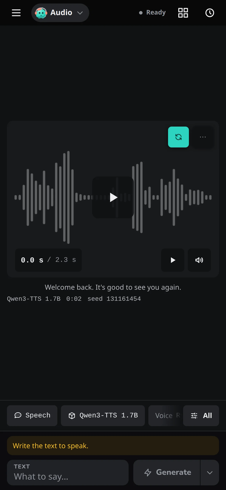

# Phones, tablets and other computers

The Web UI runs on the computer that generates, and you can use it from any browser on your network: a phone on the sofa, an iPad, or a laptop while the desktop does the work. The screens change shape to fit; this page lists what moves.

## Open it from another device { #open-it-from-another-device }

Start the Web UI so other devices can reach it:

```bash
ziv ui --host local
```

It prints this computer's network address, for example `http://192.168.1.20:8080/`. Open that address on the other device. When Windows Firewall or macOS asks whether to allow incoming connections, allow it. If the other device still can't reach it, see [Another device can't reach the Web UI](../reference/troubleshooting.md#another-device-cant-reach-the-web-ui).

!!! warning "Your network only"
    `--host local` makes the Web UI reachable by every device on your network, with no login. Anyone who can open it can browse this computer's folders and view and play its pictures, videos and audio. Use it on a network you trust.

The server only answers requests addressed to an IP address, `localhost`, the `--host` value, or this computer's name (bare and with `.local`), and refuses changes requested by other websites. To reach it under another name, list that name in `ZIV_UI_ALLOWED_HOSTS`:

```bash
ZIV_UI_ALLOWED_HOSTS=studio.lan ziv ui --host local
```

The error for a name it doesn't know is in [Troubleshooting](../reference/troubleshooting.md#another-device-cant-reach-the-web-ui).

## Keep it running

The Web UI stops when you close its terminal. To keep it going:

```bash
ziv ui --background
```

starts it, prints its address and gives you the prompt back. It keeps running after you close the terminal; its output goes to the [error log](../reference/data-folder.md#error-logs). Stop it with:

```bash
ziv ui --background-stop
```

which stops every running Web UI, including ones running in another terminal, and any job they are running.

## On a phone { #on-a-phone }

{ width="300" }

On the phone, Share → *Add to Home Screen* installs the Web UI as an app that opens without the browser's bars.

**The top strip** replaces the top bar. **Menu**, at the left, opens the other pages and the project picker. On the Workspace, the workflow menu (**Image**, **Video**, **Audio**), a status pill that opens the job's sheet and the **Gallery** button follow. On any other page the strip has a back arrow to the Workspace and the page's title, and the status pill shows while a job is active. The clock button, at the right, opens the [Job log](job-log.md).

The **Prompts page** has a layout of its own on a phone; see [The three columns](prompts.md#the-three-columns).

## Workspace on a phone

The preview is the screen:

- **Swipe sideways** through earlier outputs, and **swipe up** for the Gallery.
- **Tap** the preview to open the viewer. Pinch or double-tap to zoom. A video or take plays in the preview instead; open the viewer with the expand button in its corner.
- **Press and hold** any image, in the preview, the Gallery strip, the Gallery or the viewer, for its menu.

Under the preview, a strip shows one chip per setting with its value; tap one to change that setting, or **All** for every setting. The preset is a chip too, and a dot shows a setting that differs from its default. The controls themselves are described in [Workspace](workspace.md).

The prompt sits at the bottom beside **Generate**, with the same tabs, enhancer and prompt-file controls as on a computer.

While a job runs, a bar over the preview shows its progress with **Pause**. **⋯** on the bar opens the job's details, with **Skip**, **Repeat** and **Cancel**.

### Images on a phone { #images-on-a-phone }

One **Images** chip in the strip stands for every image the run uses, and opens one popover with the same groups as the Settings pane on a computer. It is not shown on a model that can use no image, or in the **Extend** kind of **Video** or the **Edit** kind of **Image**. **All** has the same **Images** section as a computer. See [Start from an image](../guides/images.md#start-from-an-image).

### The audio track on a phone

A **Track** chip after **Images** (after **Source** in the **Extend** kind) opens the audio track in a popover. A voice memo from your phone works as a file. See [Follow an audio track](../guides/video.md#audio-track).

### Video on a phone { #video-on-a-phone }

In **Video**, the first chip is **Kind**: **New** or **Extend**, and in **Extend** **Source** takes the place of **Images**. Each kind keeps its own prompt, model, settings and inputs when you switch. See [Extend a clip](../guides/video.md#extend-a-clip).

### Edit on a phone { #edit-on-a-phone }

In **Image**, the first chip is **Kind**: **New** or **Edit**. In **Edit**, *Image to edit* is a card above the settings chips that opens the painter, and the painter's controls sit at the foot of the screen. The chips are the ones an edit uses: **Steps**, **Seed**, **Batch**, **LoRA** and the model. See [Edit an image](workspace.md#edit-an-image) and [Edit a picture](../guides/images.md#edit).

### Audio on a phone { #audio-on-a-phone }

The **Audio** chips follow the kind, and a chip shows a ✦ when [Describe it](audio.md#describe-it) filled it. The helpers and **Insert** open as sheets, and song blocks are reordered with **Move up** and **Move down** in a block's **⋯** menu. The finished take is a player on the preview, and its **⋯** button has **Use as** → **Audio track**, **Voice** and **Saved voice**. See [Audio tab](audio.md).

{ width="300" }

## Viewer and Gallery on a phone { #the-viewer-on-a-phone }

Tapping an image grows it out of its tile into the viewer, which fills the screen.

- **Swipe sideways** and the next image follows your finger.
- **Pull down** and the image shrinks back into its tile.
- **Swipe up** for its details, which rise as a sheet under the image.
- **Tap the image** to hide the bar and the strip, and tap again to bring them back. On a video, a tap plays or pauses it instead.
- **Pinch or double-tap** to zoom, and **press and hold** for the image's menu.

A video plays in the page. Swipe over the picture to page, or drag the timeline to seek. Pause it partway and tap the time under it for the frame menu; see [Use a paused frame](gallery.md#use-a-paused-frame).

In the Gallery, a tap opens the image, and in [Select mode](gallery.md#select-move-download-and-delete) a tap picks a tile, with the actions in a bar at the foot. **Download** saves the zip through the browser, which Safari puts in Files. Tapping the page's title scrolls to the top. See [Gallery and viewer](gallery.md).

## On a tablet

Held upright, an iPad shows the preview and the Gallery strip across the top, with *Compose* and *Settings* side by side under them. Held sideways, it has the computer layout.

Any touch screen gets finger-sized controls, and numbers get − and + buttons (hold to repeat) in place of the label dragging a mouse uses.
