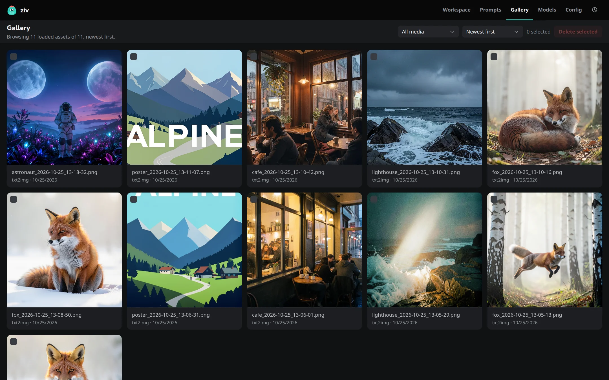
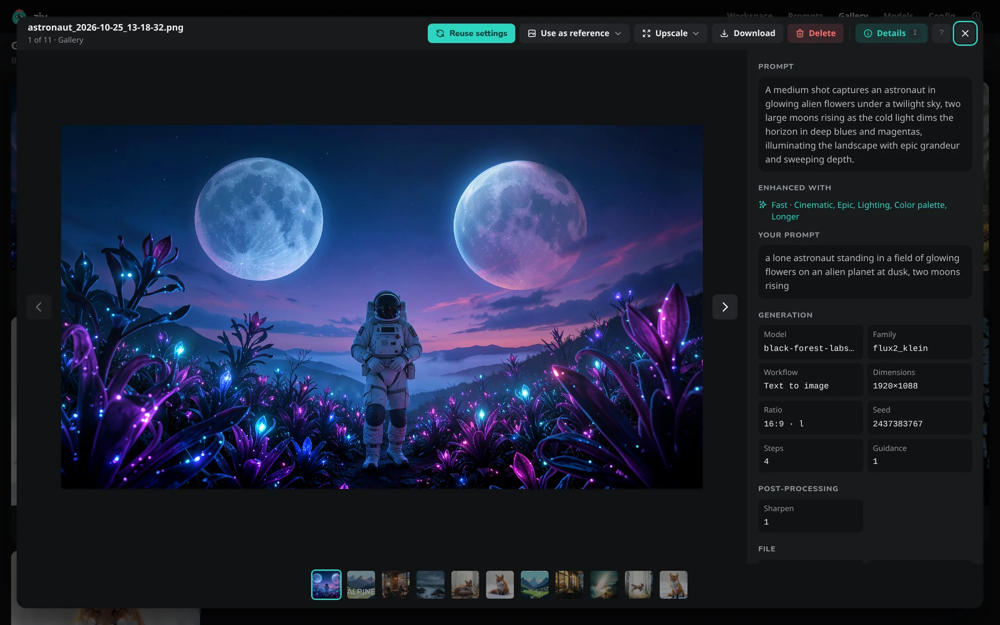

# Gallery and viewer

The **Gallery** (++g++ ++g++) shows every image and video in your output folder, including ones the CLI made there. The Workspace's Gallery strip shows the same list, so a new output or a delete shows in both.

## Browse

- **Filter** with **All media**, **Images only** or **Videos only**, and sort **Newest first** or **Oldest first**.
- Scroll down and more load in.
- Click a tile, or press ++enter++ on it, to open the viewer.
- Each tile's **⋯** menu has the same actions as the viewer, led by **Reuse settings**. Right-click a tile with a mouse, or press and hold it on a touch screen, for the same menu.
- When you come back to the Gallery, it shows what it had, scrolled to the same place, and fetches anything new.

## Select and delete

- ++space++ or ++x++ selects the focused tile; ++ctrl+a++ selects everything loaded.
- ++delete++ deletes the selection, or the focused tile, after asking.
- ++esc++ clears the selection.

Deleting removes the file from the output folder.

## The viewer

Clicking an image grows it out of its tile into the viewer. On a computer or iPad the viewer is a panel over the page, as wide as the window less a narrow margin, with the details beside the image; click outside it, or press ++esc++, to close it. On a phone it fills the screen; see [The viewer on a phone](devices.md#the-viewer-on-a-phone).

Step through the set with ++left++ and ++right++, or ++home++ and ++end++ for the first and last. Right-click the image for its menu.

| Action | Does | Key |
|---|---|---|
| **Details** | Shows the settings the file was made with | ++i++ |
| **Reuse settings** | Loads those settings into the Workspace | ++r++ |
| **Use as reference** | Opens an image as the reference for Image to Image or Image to Video, with its prompt | ++e++ |
| **Extend** | Opens a video in Extend Video | ++e++ |
| **Upscale** | Upscales an image 2× or 4×, or a video 2× (Windows and Linux) | ++x++ then ++2++ or ++4++ |
| **Download** | Saves the file to this device | ++d++ |
| Copy prompt | Copies the prompt to the clipboard | ++c++ |
| Delete | Deletes the file, after asking (++shift+delete++ skips asking) | ++delete++ |

Zoom into an image to see its real pixels: click it on a computer, or pinch or double-tap on a touch screen.

### Details

**Details** lists what the file records: prompt, negative prompt, model, seed, steps, guidance, scheduler, size, LoRAs, reference image, quant, upscale and post-processing. See [Output files](../concepts/data-folder.md#output-files).

When the prompt was enhanced, Details shows how, as one line such as *Fast · Cinematic, Melancholic, Longer*, with **Your prompt** under it.

### Reuse settings

**Reuse settings** loads the file's settings into the Workspace: model, LoRAs, quant, size, seed and the rest.

- For an enhanced prompt, **Your text** gets what you typed, **Enhanced** gets the rewrite, and the enhance options come back too.
- For a video, Scene and Action are filled. A video that was itself an extension comes back with its source.

### Use as reference

**Use as reference** opens an image as the reference image, together with its prompt:

- **For image (img2img)** puts the prompt in the Prompt box.
- **For video (img2vid)** puts it in Scene, since it describes the first frame, and leaves Action for what happens.
- **For last frame (img2vid)** makes it the last frame of a MiniMax H3 clip.

### Upscale a video

On Windows and Linux, **Upscale** on a video offers one item, such as **2× → 1536×896**, and makes `<name>_2x.mp4` with SeedVR2, keeping the frames, frame rate and sound. A size that has to go one frame at a time is marked **· very slow**. See [Upscaling an existing video](../concepts/upscaling.md#upscaling-an-existing-video).

### Upscale an image

The **Upscale** menu offers:

- **2×** and **4×**: a plain upscale that enlarges faithfully and adds fine detail. Works for any image.
- **2× creative** and **4× creative**: the image model redraws the enlarged image with the image's own settings.

Each item shows the output size, for example `2× → 1664×2432`. The job runs in the Workspace, or joins the queue. The result is saved next to the original as `<name>_2x.png` or `<name>_4x.png`.

How the two kinds differ, and when an option is unavailable, is in [Upscaling an existing image](../concepts/upscaling.md#upscaling-an-existing-image).
