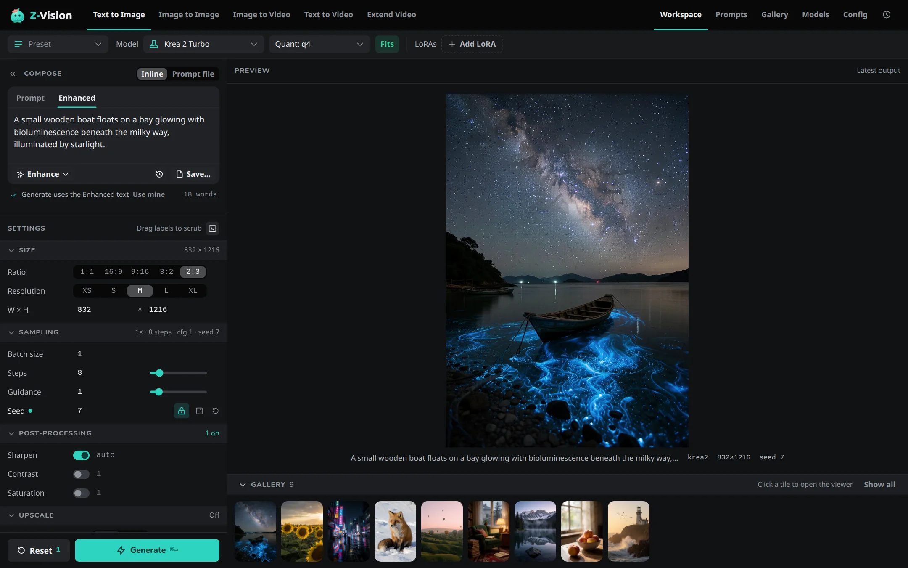

# Web UI

The Web UI is the app's browser screen. You write prompts, make images, video and audio, look through what you made and manage your models, all on one page that runs on your computer.

## Start it

```bash
ziv ui
```

It opens your browser at `http://127.0.0.1:8080/`. If port 8080 is busy it takes the next free port and prints the address. Stop it with ++ctrl+c++ in that terminal. The first start is walked through in [Install](../get-started/install.md#start-it).

| To… | Run |
|---|---|
| Start without opening a browser | `ziv ui --no-browser` |
| Use another port | `ziv ui --port 9000` |
| Open it from a phone, tablet or another computer | `ziv ui --host local` (see [Phones, tablets and other computers](devices.md)) |
| Keep it running after you close the terminal | `ziv ui --background`, and stop it with `ziv ui --background-stop` |

`ziv-ui` is the same as `ziv ui`. Every option is in the [command reference](../cli/reference.md#ziv-ui-ziv-ui).

## The screen



The **top bar** runs along the top of every page:

- **The project picker**, after the logo, sets the [project](../concepts/projects.md) you work in, or **All files**.
- **The three tabs**, on the Workspace only, choose what you make. **Audio** is left out on a machine that can't run an audio model.
- **The pages**: Workspace, Prompts, Gallery, Models and Config. While a job waits for your review before it upscales, the Workspace button carries a **Review** badge on every page. See [Review before upscaling](../concepts/upscaling.md#review-before-upscaling).
- **The clock button** opens the [Job log](job-log.md).

| Tab | Makes |
|---|---|
| **Image** | An image from a prompt, or from a start image you add in **Images** |
| **Video** | A video from a prompt, or from a first frame you add in **Images**; or, with **Extend**, more of a video you already have |
| **Audio** | Music, speech or sound, as FLAC files |

**On a phone:** the top bar becomes a strip with a menu, the workflow and the job state; see [Phones, tablets and other computers](devices.md#on-a-phone).

## The pages

| Page | Shows | Go there |
|---|---|---|
| [Workspace](workspace.md) | Prompts, settings and the preview, for Image and Video | ++g++ ++w++ |
| [Audio tab](audio.md) | The same screen for music, speech and sound | ++g++ ++w++, then the **Audio** tab |
| [Gallery and viewer](gallery.md) | Everything you made, with its settings | ++g++ ++g++ |
| [Prompts page](prompts.md) | Prompt files built without typing YAML | ++g++ ++p++ |
| [Models page](models.md) | Downloading, converting and deleting models and LoRAs, and how a model name is found | ++g++ ++m++ |
| [Config page](config.md) | Default models, base resolution, output folder and the prompt enhancer model | ++g++ ++c++ |
| [Job log](job-log.md) | Jobs that have finished, and why one failed | ++g++ ++j++ |
| [Phones, tablets and other computers](devices.md) | Opening the Web UI from another device, and how its layout changes | |
| [Keyboard shortcuts](shortcuts.md) | Every key, in one table | <kbd>?</kbd> |
