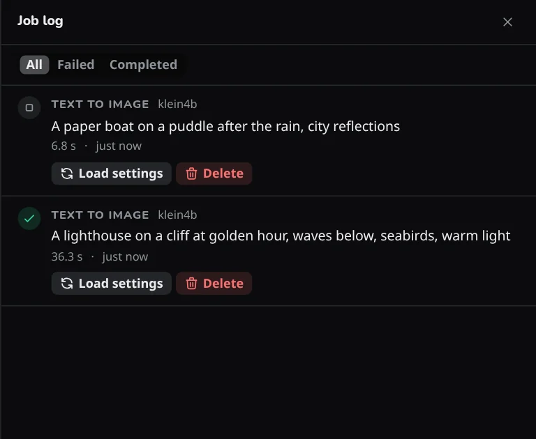

# Job log

The **Job log** is a side panel that lists the jobs that have finished, newest first. Open it with the clock button in the top bar, or press ++g++ then ++j++. It is where to look when a job failed and you want to know why; the likely causes are in [Troubleshooting](../reference/troubleshooting.md#a-job-failed).

{ width="420" }

## Each row

A row shows the workflow, the model, the first line of the prompt and how long the job took, with a mark for **Completed**, **Failed**, **Cancelled** or **Some runs failed**. **Show details** expands a row to the failure text and how many runs failed.

**On a phone:** the clock button is at the right end of the top strip; see [Phones, tablets and other computers](devices.md#on-a-phone).

**All**, **Failed** and **Completed** narrow the list, and older jobs are on further pages.

## Actions

- **Load settings** opens the Workspace with the settings that job used, with the model's defaults around them. It is not offered for an upscale.
- **Copy error** copies the failure text of a job that has one.
- **Delete** removes one entry, and **Clear log** removes the whole log, after asking, under **All** only.

## What is kept

The log is kept in the app database in the [data folder](../reference/data-folder.md#job-log), so it survives a restart. Entries stay until you delete them or clear the log. Jobs removed from the queue before they started are not recorded.
