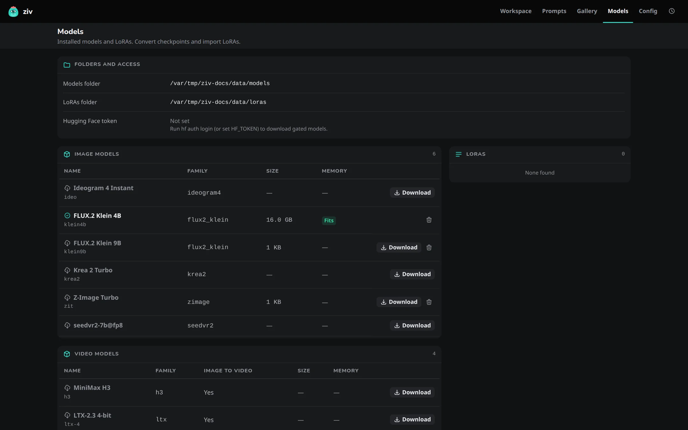

# Models page

The **Models** page (++g++ ++m++) lists every model and LoRA the app can use. Here you download models ahead of time, see how much disk they use, convert checkpoints, import LoRAs and free space.

## The tables

| Table | Lists |
|---|---|
| **Image models** | Built-in models such as FLUX.2 Klein 9B, and models you converted |
| **Video models** | `ltx-4`, `ltx-8` and converted LTX fine-tunes |
| **LoRAs** | The files in `~/.ziv/loras/` |
| **Prompt enhancer** | **Fast**, **Smart** and, when set on the Config page, **Custom** |
| **Other downloads** | Hugging Face downloads that nothing uses any more |

A built-in model shows its name with its alias under it, for example FLUX.2 Klein 9B and `klein9b`. The alias is what you use in the CLI and in prompt files.

**Size** is the disk the model uses. For a built-in model that's its Hugging Face download; for a converted model it's its own folder, without the base-model files it links to. Quantized copies count with their model.

**Memory** shows whether the model fits this machine. See [Memory](../concepts/memory.md).

## Download ahead of time

A row whose files aren't fully downloaded has a **Download** button. Without it, the first job that needs the model downloads it and shows the progress on its card.

1. **Download** first shows the download's size and the free space on the drive. When the space looks short, **Download anyway** replaces the button.
2. Downloads run one at a time, beside your jobs: they don't take a place in the job queue, so you can generate while one runs. Later downloads wait as **Queued**.
3. **Cancel** on a row stops a running download or removes a queued one. Finished files are kept, so the next Download continues with the rest.

A job that needs a model being downloaded waits for it and shows its progress. Cancelling that job leaves the download running.

!!! note "Two special rows"
    - **Ideogram 4 Instant** (`ideo`): Download fetches its source files. The first job then builds the model folder from them. See [Ideogram 4 Instant](../concepts/models.md#ideogram-4-instant).
    - **SeedVR2**, the model behind the plain image upscale and, on Windows and Linux, the video upscale: on a Mac, the first plain upscale makes an 8-bit copy and removes the download. See [Upscaling](../concepts/upscaling.md#plain-upscale).

If Hugging Face can't be reached, the size can't be read and the download can't start. A model that needs a license or a login shows one line saying what to do. See [Hugging Face token](../concepts/data-folder.md#hugging-face-token).

## Delete and free space

Each row has a delete button, which appears as soon as any of the model's files are on disk, so an interrupted download can be cleared too. It asks first, and is unavailable while jobs are running or queued, or while that model is downloading.

| Row | Delete removes |
|---|---|
| Converted model | Its folder in `~/.ziv/models/`. Base-model files it links to are kept. |
| Built-in model | Its Hugging Face download, including a partial one. The model downloads again the next time you use it. The confirmation lists converted models that link to it, because they stop working until it's downloaded again. |
| MiniMax H3 | Its download, the repositories it downloads beside it, and its prepared copy (`h3@q4`, or `h3@mlx-te4` on a Mac). A converted H3 model is a folder of its own and is left alone, but it needs `h3`'s parts to run, which its next use downloads again. |
| LoRA | The `.safetensors` file. |
| Prompt enhancer model | Its download, including a partly finished one. A custom model in a local folder is never deleted. |
| Quantized copy | The stored `q8` or `q4` copy. See [Stored quants](../concepts/quantization.md#stored-quants). |
| SeedVR2 | Its folder. The next plain upscale downloads it again. |

**Other downloads** lists models in the Hugging Face cache that no model, enhancer or converted model uses, for example a model another tool downloaded, or one left behind by a model you deleted. The size is what deleting it frees. The cache is shared with other apps on your computer, so another app may download a deleted repo again.

**Unused cache files** appears when the cache holds files that no download links to any more, left behind by deletes outside the app. Deleting them frees that space without touching any download.

## Convert a checkpoint

**Convert a checkpoint** turns a single `.safetensors` file, such as a community fine-tune, into a model you can pick by name.

1. Choose the **Checkpoint file** and a **Name**.
2. Pick the **Model type**: Z-Image, FLUX.2 Klein 4B or 9B, Krea 2 Turbo, LTX-2.3 (video), LTX-2.5 (video) or MiniMax H3 (video).
3. Optionally save a **Quantized copy** at `q8` or `q4`.

For the video types, the form reads the checkpoint and shows its version or layout. For **LTX-2.3** and **LTX-2.5** it preselects the **Quantize level** that fits this machine (q4 for LTX-2.5) and, for a plain-dev checkpoint, **Distillation**. For **MiniMax H3** it has **Already step-distilled**, shows what the file's name or metadata hint, and leaves the choice to you. Progress shows while it converts.

What each type accepts is in [Converting checkpoints](../cli/models.md#convert-a-checkpoint).

## Import a LoRA

- **Import a local LoRA** copies a `.safetensors` file into `~/.ziv/loras/`.
- **Download a LoRA from Hugging Face** fetches one from a repository; name the **File** when the repository has several.

The LoRA is then in the Workspace's LoRA picker. See [LoRAs](../concepts/loras.md).
