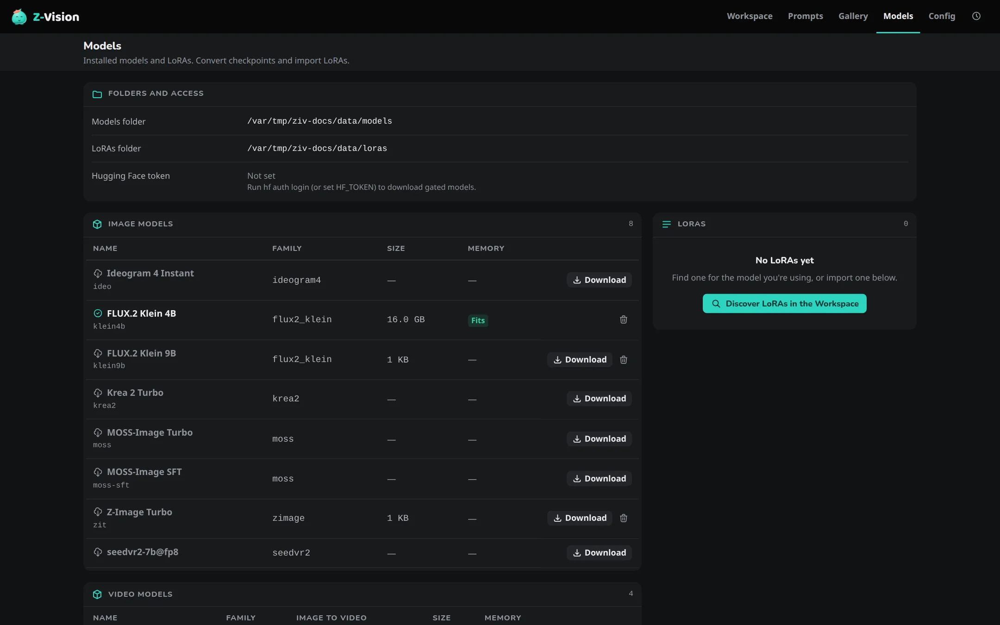
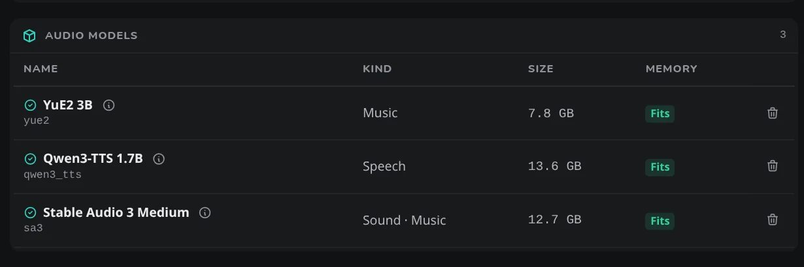

# Models page

The **Models** page (++g++ ++m++) lists every model and LoRA the app can use, with the disk each takes and whether it fits this machine. It is also where you download models ahead of time, convert checkpoints, import LoRAs and free space.

## Folders and access

A panel at the top shows the **Models folder**, the **LoRAs folder** and whether a **Hugging Face token** was found, which gated models need. The [Config page](config.md#folders-and-access) has a similar panel, which shows the **Model cache** instead of the **Models folder**.

## The tables

| Table | Lists |
|---|---|
| **Image models** | Built-in models such as FLUX.2 Klein 9B, models you converted, and stored quantized copies |
| **Video models** | LTX-2.3 4-bit, LTX-2.3 8-bit, LTX-2.5 4-bit and MiniMax H3, and converted LTX and MiniMax H3 models |
| **Audio models** | YuE2 3B, Qwen3-TTS 1.7B and Stable Audio 3 Medium |
| **Prompt enhancer** | **Fast**, **Smart** and, when set on the Config page, **Custom** |
| **Background removal** | The cut-out models of [Transparent background](../guides/images.md#transparent-background), as one row |
| **LoRAs** | The files in `loras/` in the data folder |
| **Other downloads** | Hugging Face downloads that nothing uses any more, and **Unused cache files** |

Under a built-in model's name is its alias, such as `klein9b` under FLUX.2 Klein 9B (see [Names and aliases](#names-and-aliases)). A stored quantized copy reads *q8 copy of* its base model, and a converted video model reads *Converted at q4*, the one level it is stored at. The **ⓘ** after a built-in model's name shows its licence; see [Licences](../reference/models.md#licences).

**Other downloads** lists models in the Hugging Face cache that no model, enhancer or converted model uses, for example one another tool downloaded or one left behind by a model you deleted. **Unused cache files** appears when the cache holds files no download links to any more, left behind by deletes outside the app.

**Size** is the disk the model uses: for a built-in model its Hugging Face download, for a converted model its own folder without the base-model files it links to. Quantized copies count with their model. **Memory** is the badge from the Workspace; see [The memory badges](../concepts/memory.md#the-memory-badges).

## Names and aliases { #names-and-aliases }

A model has a name wherever you pick one: the **Model** menu in the Workspace, `-m` on the command line, a prompt file, `config.yaml`. The Web UI shows a built-in model by its name, such as FLUX.2 Klein 9B, and this page lists the alias under it. The alias is what you type with `-m`. An alias of your own shows as its alias, and a converted model by the name you gave it.

How a name you type is resolved, and every built-in alias, is in [How a name is found](../reference/models.md#how-a-name-is-found).

## Download and Cancel

**Download** on a row asks before the download starts; **Cancel** there starts nothing. Downloads run one at a time, beside your jobs, and later ones wait as **Queued**. **Cancel** on a running or queued download keeps the finished files. A job that needs a model being downloaded waits for it. How to use these is in [Download a model ahead of time](../guides/models.md#download-a-model-ahead-of-time).

## Delete { #delete-and-free-space }

Each row has a delete button once any of its files are on disk, so an interrupted download can be cleared too. It asks first, and is unavailable while jobs are running or queued, or while that model is downloading. What each kind of row removes, and what a converted model keeps, is in [Delete models and free space](../guides/models.md#delete-models-and-free-space).

## Convert a checkpoint { #convert-a-checkpoint }

**Convert a checkpoint** turns a single `.safetensors` file, such as a community fine-tune, into a model you can pick by name. How to do it, and what each type accepts, is in [Convert a fine-tune](../guides/models.md#convert-a-checkpoint).

The form takes a **Checkpoint file**, a **Name** for the app's lists and a **Model type**, and the rest depends on the type:

- **Image types** have **Base model (optional)**, a Hugging Face repo or folder that supplies the parts the checkpoint lacks. Only `zimage` uses it, and it defaults to `Tongyi-MAI/Z-Image-Turbo`. **Quantized copy (optional)** can also save a `q8` or `q4` copy. **Copy instead of moving** copies those base-model files into the new folder instead of linking them; the checkpoint itself is never moved.
- **LTX-2.3 and LTX-2.5** read the checkpoint and show its version, with advice. **Quantize level** is `q4` or `q8` (the only level stored), and **Distillation** merges Lightricks' distilled LoRA into a plain-dev checkpoint. The level that fits this machine is preselected.
- **MiniMax H3** shows what the file's name or metadata hint, with **Already step-distilled** for a checkpoint that already runs at 4 or 8 steps.

## Import a LoRA { #import-a-lora }

Two forms add a LoRA to the **LoRAs** table. How to use them is in [Import a LoRA](../guides/models.md#import-a-lora).

- **Import a local LoRA** copies a `.safetensors` file (**LoRA file**, with an optional **Name**) into `loras/` in the data folder.
- **Download a LoRA from Hugging Face** fetches one from a **Repository** (`owner/repository`); **File** names the file in it, and **Name** is optional. The download shows as a row of the table with **Cancel**, like a model download.

Deleting a LoRA also removes its chips in the Workspace, and can't be done while a job runs.

### Discover LoRAs

**Discover LoRAs in the Workspace** on the **LoRAs** table switches to the Workspace and opens [Discover LoRAs](workspace.md#discover-loras) for the model you have chosen there; the Models page has no drawer of its own.
