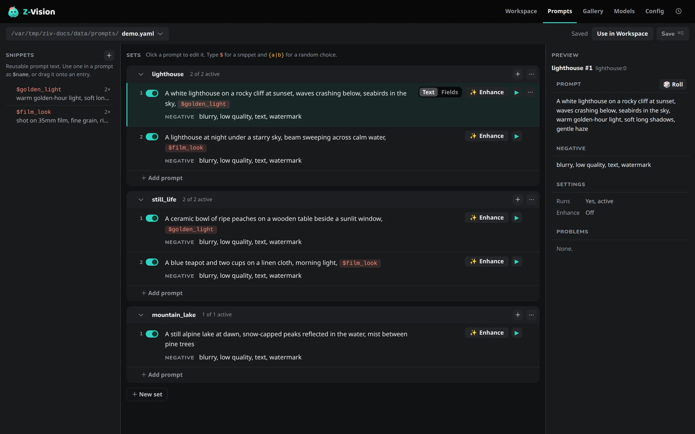

# Prompts page

The **Prompts** page (++g++ ++p++) builds [prompt files](../concepts/prompt-syntax.md#prompt-files) without typing YAML. It reads and writes the same files the command line uses, and keeps their comments, quoting and `|` blocks. How to write a file, pick a set and run it is in [Run batches from prompt files](../guides/batches.md#write-a-prompt-file).

## The file menu

The button at the top left opens a recent prompt file, browses for one on the server's machine, creates a new one, or reloads the open file from disk and drops unsaved changes, after asking.

A file that isn't valid YAML, or isn't shaped like a prompt file, opens in a repair view with its raw text to fix, instead of the builder.

## The three columns

**On a phone:** one column shows at a time, chosen with the **Snippets**, **Sets** and **Preview** switch above them. In a window narrower than about 1100 px the **Preview** column is left out.

### Snippets

Snippets are reusable pieces of text you put in prompts as `$name`; see [Snippets](../concepts/prompt-syntax.md#snippets).

Drag a snippet onto a prompt to add a `$reference`. Renaming a snippet updates every reference to it, and deleting one that is used warns first.

### Sets and prompts

Sets are panels of prompts, one card each. A set's name starts the file names of what it makes.

Drag a set or a prompt by its ⠿ grip to reorder it; drop a prompt on another set's header to move it there.

A prompt card's **active** switch decides whether the prompt runs: inactive prompts are skipped when the file runs. Its ✨ **Enhance** is off, the default rewrite, or chosen [enhance options](../concepts/prompt-enhancer.md#options). **Text** and **Fields** on the card switch a prompt between plain text and named fields.

### Edit a prompt

`$snippets` show as chips, red when undefined. `{a|b}` random choices show as pills; click one to edit its options, one per line, where an empty line is an empty option. The keys for editing and for random choices are in [Keyboard shortcuts](shortcuts.md#prompts-page).

### Fields

A prompt written as **Fields** is a list of named values, such as **Subjects**, **Setting** and **Style**, that the model receives as one text, each as `name: value`. A prompt that holds lists or nested fields shows them flattened and keeps them as written; **Convert to text** turns them into one line of text, after asking, and the prompt the model receives stays the same. See [Structured prompts](../concepts/prompt-syntax.md#structured-prompts).

### Scenes

A video prompt can have a **Scene** that describes who and where, the look and the camera, above the **Prompt**, which says what happens. **Add scene** in a prompt's **⋯** menu adds the Scene field and **Remove scene** takes it away. See [Scenes for video](../concepts/prompt-syntax.md#scenes-for-video).

### Preview

The preview shows the selected prompt as the model receives it: snippets filled in, fields flattened, with the **Scene**, **Prompt** and **Negative** boxes, its settings (whether it runs, its enhance options) and any problems. **🎲 Roll** picks one option of every random choice, as a run would; **Show choices** goes back.

## Generate from here

**▶ Generate this one** on a prompt saves the file, then queues that one prompt with the current Workspace settings (it is greyed while the prompt is off). **Use in Workspace** saves the file and selects it in the Workspace as the prompt source. A prompt file belongs to **New**, so an **Image** tab left on **Edit** opens on **New**; Edit's image and paint stay. See [Pick a prompt set and run it](../guides/batches.md#pick-a-prompt-set-and-run-it).

## Save

**Save** writes the file.

- Saving is blocked while the file has errors that would stop it from loading: an undefined snippet in an active prompt, an empty prompt, or two sets with the same name. Warnings, such as an invalid `enhance:` block, don't block saving.
- If the file changed on disk since you opened it, for example in another editor, saving asks before overwriting it.
- Prompts selected in the Workspace keep pointing at the same entries, even after you reorder, move or rename them.

Undo goes back to the last save. Unsaved changes are kept in the browser, so leaving the page or reloading doesn't lose them; reopening the file offers **Restore** or **Discard**.

## Save a Workspace prompt

**Save** in the Workspace prompt box's tools row appends the prompt you are looking at to a prompt file. It shows when the prompt source is **Inline**.

- **What is saved:** the text in the box. In the **Prompt** tab that's your own text; in the **Enhanced** tab it's the rewrite. Video also saves the scene, and the negative prompt is saved when it's shown.
- **Where it goes:** the end of the set named `prompts`, added at the end of the file when missing. You choose the file, or make a new one.
- **The file:** comments are kept. A file with errors, such as an undefined `$snippet`, is left unchanged and the message says what to fix.
