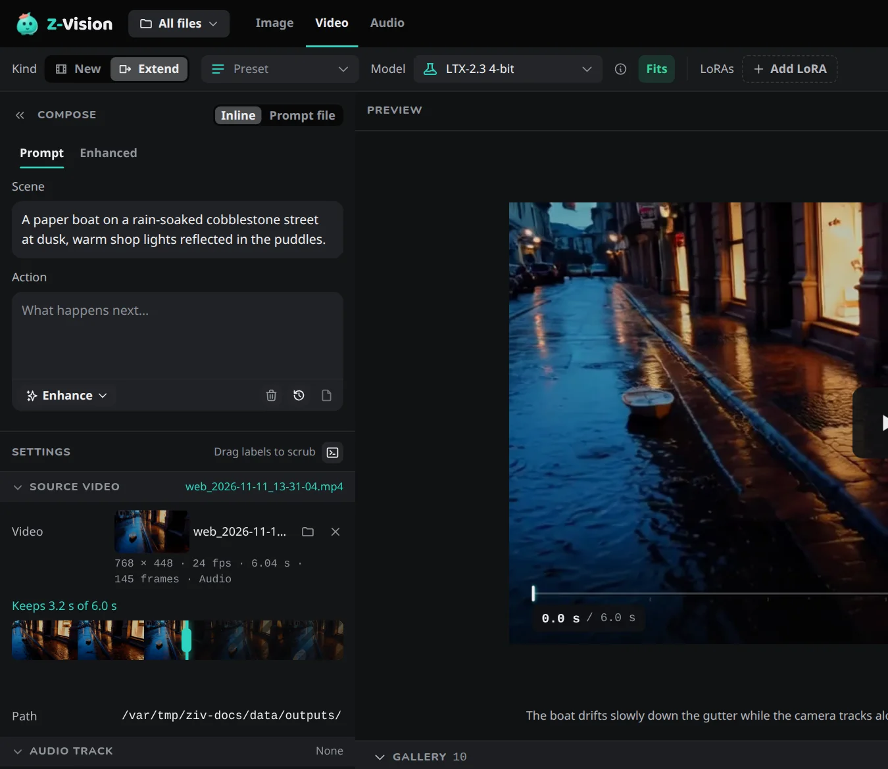
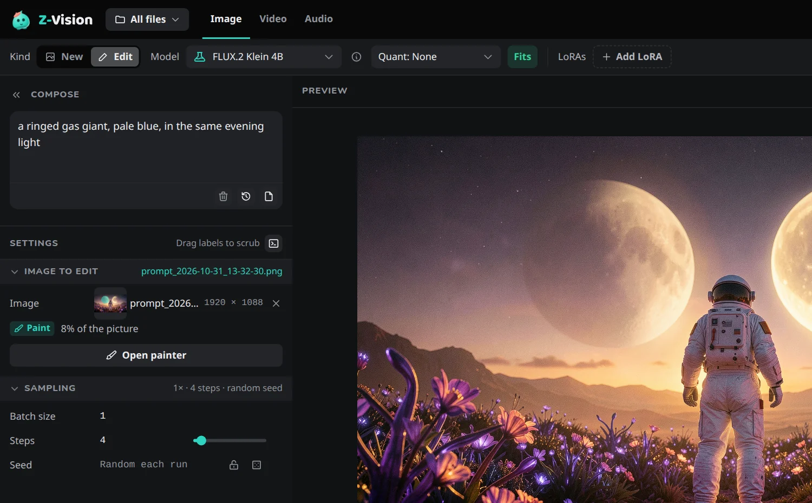
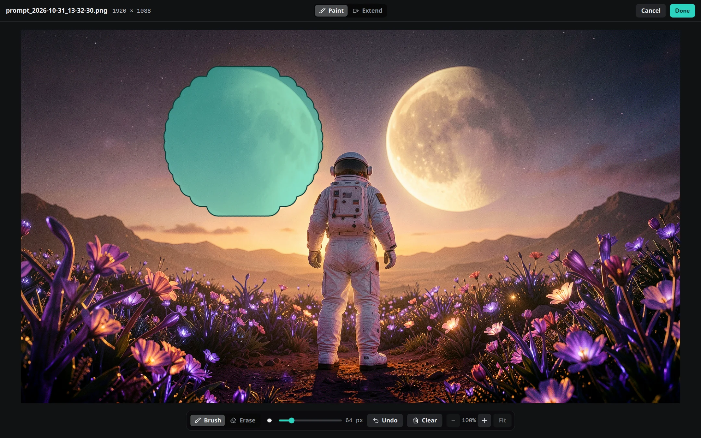
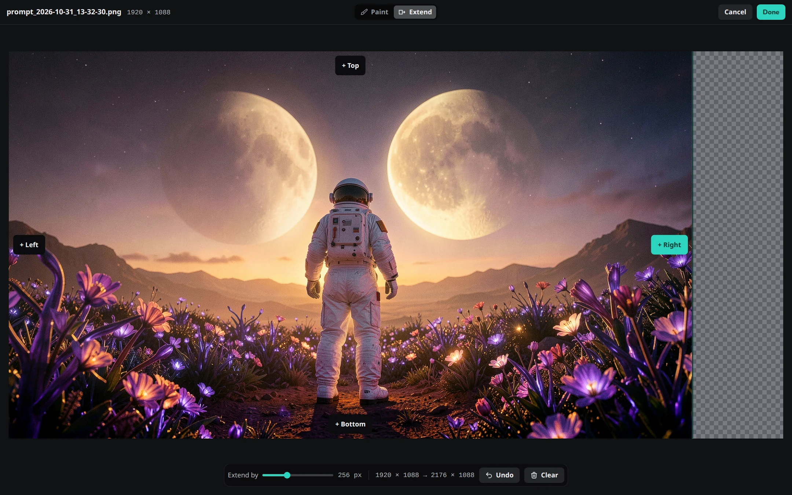

# Workspace

The Workspace is where you make images and videos. A toolbar picks the model, the sidebar holds *Compose* and *Settings* with **Generate** at its foot, the middle shows the running job and the latest result, and the Gallery strip runs under it. [Audio](audio.md) has its own page. How to make things is in [Make images](../guides/images.md) and [Make video](../guides/video.md).

## The top bar and tabs { #the-top-bar }

On the Workspace the top bar has the **Image**, **Video** and [**Audio**](audio.md) tabs. **Image** and **Video** each keep their own prompt, model, settings and preset, and each comes back as you left it. **Audio** is hidden on a computer that can't run an audio model.

**Video** has two kinds, chosen with **Kind** at the start of the toolbar: **New** makes a clip from text or a first frame, and **Extend** continues a clip you already have. Extend keeps its own prompt, model, settings, **Batch size** and **Seed**, and nothing you do in one kind changes the other. **Kind** is hidden on a computer that can't extend. See [Make video](../guides/video.md#extend-a-clip).

**Image** has two kinds as well: **New** generates a picture, and **Edit** changes part of one you already have, or gives it more room (see [Edit an image](#edit-an-image)). Edit keeps its own prompt, model, settings, **Batch size** and **Seed** in the same way.

**On a phone:** the tabs are the workflow menu in the top strip, and the pages are in the menu at the top left. See [Phones, tablets and other computers](devices.md#on-a-phone).

## Project

The project picked in the top bar decides which files the preview, the Gallery strip and the latest image and video that **Images** offers show, and where new work is saved. A [notice](#notices) says where a result went when it is in another project. See [Projects](../concepts/projects.md).

## Model and LoRAs

The toolbar above the sidebar and the preview picks the **Model** for the current tab, its quantization (**Quant**, for models that have one) and its **LoRAs**. On a phone it heads the **All** sheet.

Each model carries a memory badge; see [The memory badges](../concepts/memory.md#the-memory-badges).

Which LoRAs are offered, and how they are remembered per model, is in [LoRAs](../concepts/loras.md#use-one).

### Discover LoRAs

**Discover LoRAs…**, the last item of **Add LoRA**, searches your installed LoRAs, the curated list and Hugging Face; the first use of **Hugging Face** asks you to confirm its results. See [LoRAs](../concepts/loras.md#discover-loras).

## Presets

A **preset** saves a setup under a name. The **Preset** control is in the toolbar on **Image** and **Video**, each with its own list, and comes after **Kind**. **Audio** and the **Edit** kind of **Image** have none. A dot on the control shows when the form differs from the applied preset.

{ width="540" }

What a preset keeps and leaves alone, and where the files live, is in [Save a setup as a preset](../guides/better-results.md#save-a-setup-as-a-preset). Switching between **Image** and **Video**, or between **New** and **Extend**, leaves each one's preset as it was.

**On a phone:** the preset is a chip in the strip under the preview, after **Kind**.

## Compose

*Compose* is the top of the sidebar: where the prompt comes from, the prompt box and its tools. Writing prompts is covered in [Write a clearer prompt](../guides/better-results.md#write-a-clearer-prompt).

### Prompt source

**Prompt source** chooses between **Inline**, the prompt you type, and **Prompt file**, prompts from a YAML file on the machine running the server. With a prompt file, **Prompts…** chooses which sets and prompts run, and **Edit** opens the file on the [Prompts](prompts.md) page. See [Run batches from prompt files](../guides/batches.md#pick-a-prompt-set-and-run-it).

### The prompt box

For video, *Compose* has a **Scene** box above the **Action** box. A **Negative prompt** box appears for models that use one.

**Generate** sends, for each part of the prompt, the [prompt enhancer](../concepts/prompt-enhancer.md)'s **Enhanced** text when there is any, and your own text otherwise. A video has one header and one stepper for its Scene and Action together.

- A **⚠** on the **Enhanced** tab means the Enhanced text is out of date, because your text or the model changed since it was written. It is still sent until you scratch it or enhance again.
- **✕** after the tab scratches the Enhanced text, so **Generate** sends your text again, and **‹** brings it back.
- `‹ 2 of 3 ›` steps through the last five versions. **Generate** sends the version shown, and typing edits that version. Versions are kept in the browser, not on the server.

With the JSON box on, or with **Enhance each image when generating** on, the header is a single **Prompt** heading with no tabs: **Generate** sends the text in the box (or, for each image, your prompt rewritten as the job runs), and nothing is out of date.

**The tools row** under the box holds **Enhance**, **JSON caption** (Ideogram 4), **Clear**, **Triggers**, **Recent prompts** and **Save**.

- **Enhance** opens [the Enhance panel](#the-enhance-panel).
- **JSON caption** swaps the prompt for a structured caption in a **Prompt (JSON)** box, and hides **Enhance** and **Save** while it is on.
- **Clear** empties your text, the Enhanced text and its versions (with JSON on, the JSON prompt), and a video's Scene and Action together. **Undo** in the line under the box brings it back until your next edit or run there.
- **Triggers** puts a trigger word of a LoRA in use into the prompt. See [LoRAs](../concepts/loras.md#trigger-words).
- **Save** appends the prompt to a prompt file, with **Inline** only. See [Save a Workspace prompt](prompts.md#save-a-workspace-prompt).

### The Enhance panel

The ✨ button opens a popover (a sheet on a tablet or phone) with the choices that steer the rewrite. What each choice does is in [Prompt enhancer](../concepts/prompt-enhancer.md#options), and how to use the enhancer is in [Let the enhancer add detail](../guides/better-results.md#let-the-enhancer-add-detail). **Reset** puts every choice back to **Keep**; image and video remember their own choices.

{ width="420" }

**Generate** waits while **Enhance**, a helper or **Fill in** is writing. While jobs run or are queued, the panel is unavailable, because the enhancer needs the same memory; enhancing inside each job still works. The first use downloads the enhancer.

### Recent prompts

The 🕘 button lists the prompts you generated in the current mode, newest first: image prompts in **Image**, video prompts (a scene and an action together) in **Video**, whichever kind. The filter searches all of that mode's prompts, not only the ones shown.

- **Pick a row** to bring the prompt back: the prompt, a video's scene and the negative prompt go into their boxes, and any Enhanced text and its versions are dropped. Settings, model and tab don't change. JSON rows are greyed out, with the reason, on a model that takes no JSON captions.
- **Clear recents** removes the prompts of the list you are in, after asking. Every other list stays.

Recents are kept in the app database on the server, not in the browser, so they are the same on every device you open the Web UI from. Prompts that come from a prompt file are not recorded, and neither are refused or blank submits.

## Settings

*Settings* holds everything else, grouped, with **Copy CLI command** in its header (see [Copy as a command](#copy-as-a-command)) and **Reset** and **Generate** at its foot. On a phone, a strip of chips under the preview opens each setting in a sheet; see [Phones, tablets and other computers](devices.md#on-a-phone).

| Group | Has | How to use it |
|---|---|---|
| **Size** | **Ratio**, **Resolution**, or a custom **W × H** | [Pick a size](../guides/images.md#pick-a-size) |
| **Sampling** | **Steps**, **Guidance**, **Scheduler**, **Seed**, **Batch size**; in Video, **Duration (s)**, and in the Extend kind **Extend by (s)** and **Total** | [Set steps, guidance and seed](../guides/images.md#set-steps-guidance-and-seed) |
| **Images** | The start image, [references](#references), or a video's first and last frame. See [Images](#images) | [Start from an image](../guides/images.md#start-from-an-image) |
| **Image to edit** | In the Edit kind of Image, the picture to change and its paint. See [Edit an image](#edit-an-image) | [Edit a picture](../guides/images.md#edit) |
| **Source video** | In the Extend kind of Video, the clip to continue. See [Source video](#source-video) | [Extend a clip](../guides/video.md#extend-a-clip) |
| **Audio track** | In Video, an audio file the clip follows. See [Audio track](#audio-track) | [Follow an audio track](../guides/video.md#audio-track) |
| **Upscale** | Images only: the factor, **Denoise**, and **Review** before upscaling | [Get a larger image](../guides/images.md#upscale-while-generating) |
| **Post-processing** | **Sharpen**, **Contrast**, **Saturation** and **Transparent** (images) | [Sharpen and adjust contrast and saturation](../guides/images.md#sharpen-and-adjust-contrast-and-saturation) |
| **Video** | **Audio**, **Low memory**, and the clip's own **Upscale** with its factor and **Review** | [Add sound or an audio track](../guides/video.md#sound), [Video as it's made](../concepts/upscaling.md#video-upscale) |

Groups and rows only show when the model and tab use them.

- **Change a number** by typing it, or by dragging its label sideways.
- **Batch size** is the number of runs. Every tab and kind keeps its own.

### Seed

The **Seed** field reads *Random each run* until you type a number. **Lock seed** reuses one seed every run, starting from the seed of the newest output in the Gallery (or a random one if there is none), so the next run starts from the last one. **New random seed** fills in a new number and locks it. Making variations with a seed is covered in [Make variations with Reuse and a new seed](../guides/better-results.md#make-variations-with-reuse-and-a-new-seed).

### Transparent background

**Transparent** in **Post-processing** switches on [Transparent background](../guides/images.md#transparent-background). The **Non-commercial** button beside it opens the cut-out models' terms.

### Images

The **Images** section holds every image the run uses: in **Image**, the start image and, on FLUX.2 Klein, [references](#references); in **Video**, a first frame and an optional last frame. With none, **Generate** works from the prompt alone. What each is for is in [Start from an image](../guides/images.md#start-from-an-image) and [First and last frame](../guides/video.md#first-and-last-frame).

- An image stays until you press its **×** or **Reset**, also after a reload. **Image** and **Video** each keep their own, and switching tabs, kinds or models clears none of them.
- An image the model can't use is hidden: not shown, not sent, not counted. It stays in the draft and comes back on a model that can use it.
- An image that **Generate** would use but can't find blocks **Generate**, with the reason above the button. See [Generate is greyed out](../reference/troubleshooting.md#generate-is-greyed-out).

**On a phone:** one **Images** chip opens the same groups in a popover. See [Images on a phone](devices.md#images-on-a-phone).

#### References

Models that take [references](../guides/images.md#references) offer up to four. A row's position is its number in the prompt: *Reference 1* is "image 1". Removing a row renumbers the rest. **Use as** → **Reference** in the [Gallery or viewer](gallery.md#use-as) adds an image as the next number and keeps the prompt.

### Source video

In the **Extend** kind of **Video**, **Source video** holds the clip to continue, chosen with **Browse**, by path, or with **Extend** in the [Gallery or viewer](gallery.md#the-viewer). A **handle** on the strip of its frames sets where the extension continues from; it stops at frame 25. What a point does is in [Extend from a point](../guides/video.md#from-a-point).

The point belongs to the source: choosing another source puts the handle back at the end, and a video paused in the viewer arrives with its point set.

### Audio track

In **Video**, either kind, the **Audio track** section takes an audio file the clip follows, with **Start at** in seconds. See [Follow an audio track](../guides/video.md#audio-track). In the **Extend** kind, choosing a source made from a track fills in that track from where its sound ended; a track you chose yourself stays when you change the source.

### Image to edit { #edit-an-image }

**Edit** is a kind of the **Image** tab, chosen with **Kind**. It shows only the controls an edit uses, with a prompt box of its own; it has no preset, prompt file or **Enhance**, and offers only the models that can edit. What an edit does, and how to make one, is in [Edit a picture](../guides/images.md#edit).

*Image to edit* in *Settings* holds the picture. Empty, it is a drop zone with **Browse**, **Upload** and **Latest output**. With a picture chosen it shows the name and size with a **×** to clear it, **Open painter**, and one line that says what will be sent:

- **Paint** and the painted share of the picture, or *Whole picture, from the prompt* when nothing is painted;
- **Extend**, the side, the amount and the new size, or *No side chosen yet*;
- *Paint the area again*, after **Reuse settings** on a painted edit, because the paint isn't saved.

The prompt box asks *What should be here?* for a painted area or a new strip, and *What should change?* for a whole-picture edit. **Generate** is off with its reason shown: *Choose an image to edit*, *Choose a side to extend*, or *Paint the area to change* for a picture with transparent parts. **Edit** on a finished picture in the [viewer](gallery.md#the-viewer) (++m++) or a tile's **⋯** menu opens it here with an empty prompt.

#### The painter { #the-painter }

The painter fills the screen, opened with **Open painter**. The **Paint** / **Extend** switch sits at the top, with **Cancel** and **Done**. **Done** keeps the work; **Cancel** puts it back as it was when the painter opened, asking first if something changed.

**One mode at a time.** Only the active mode's work is sent. Switching removes the work of the mode you leave: the painter asks first, and **Undo** brings it back. ++1++ switches to Paint and ++2++ to Extend. With nothing painted and no side chosen, the prompt changes the whole picture. How to use each mode is in [Edit a picture](../guides/images.md#edit).

- **Paint:** **Brush** and **Erase**, a size slider, **Undo**, **Clear** and zoom. The painted area shows as a teal fill. Keys are in [Shortcuts](shortcuts.md#painter).
- **Extend:** **+ Top**, **+ Right**, **+ Bottom** and **+ Left** on the picture's edges grow one side, by **Extend by** 128 to 512 pixels, with the new size shown. Extend is off for a picture with transparent parts; hover the button to see why.
- **Mouse and pen** paint. **On a touch screen** one finger paints and two fingers zoom and pan.

**On a phone:** see [Edit on a phone](devices.md#edit-on-a-phone).

### Settings are remembered

Your settings stay in the browser between visits, as long as the Web UI starts on the same port.

When you choose another model, the settings you changed are kept and the rest take the new model's defaults. A size the new model doesn't offer becomes its largest preset. **Reuse settings** and **Load settings** replace the open tab's settings instead, and leave the other tabs and kinds alone; see [Reuse settings](gallery.md#reuse-settings).

### Reset

**Reset** at the foot of *Settings* puts the open tab or kind back to its defaults: its settings, images, audio track and *Enhance* options, and the applied preset is deselected. On Extend it also clears the source video and the point, and on Edit the image and its paint. It keeps the model, LoRAs, quant and prompts, and never touches another tab or kind. Every tab and kind keeps its own **Batch size** and **Seed**, and a Reset puts the open one's back. What **Reset** puts back on Audio is in [Audio tab](audio.md#settings).

### Copy as a command

The terminal button in the *Settings* header copies a `ziv image`, `ziv video` or `ziv audio` command with the current model, prompt, LoRAs and settings, writing to the folder the job would save to (the Web UI's output folder, or the picked [project's](../concepts/projects.md)). Paste it in a terminal to run the same job. A notice says when the command would do something different; an uploaded start image or reference is named by its file name, so replace it with the file's path. An edit's command names the image with `--edit`, and a painted one names `--mask mask.png`, a placeholder for the painted area saved as a PNG with the shape of the image. See [Copy a command from the Web UI](../cli/index.md#copy-a-command-from-the-web-ui).

### Paths on the server

Fields that take a path on the server's machine (prompt files, the output folder, checkpoints, LoRAs, images, audio tracks, source videos) have a folder button that opens a file browser inside the Web UI, so it works the same on every system and from a phone. With a [project](#project) picked, an empty image, audio track or source video field opens in the project's folder. Keys are in [Keyboard shortcuts](shortcuts.md#file-browser-and-paths).

## Generate

**Generate** is at the foot of *Settings*; its keys are in [Keyboard shortcuts](shortcuts.md#workspace). **On a phone,** press and hold **Generate**, or tap the arrow beside it, for **Generate with a new seed**.

While a job runs, **Generate** reads **Add to queue**; see [The queue](#the-queue).

- **When it can't start,** the reason shows above the button. See [Generate is greyed out](../reference/troubleshooting.md#generate-is-greyed-out).
- **While a model or LoRA downloads,** it waits for the file and starts the job when the download ends.
- **When the model isn't downloaded,** it asks before the download starts; **Cancel** queues nothing.

### While a job runs

{ width="420" }

The **live preview** shows the current image taking shape after every step, so you can skip a bad one early. It is never saved, and a video shows none while it is made. Jobs already in the queue don't ask about downloads; they download when their turn comes. If a job fails, the card says why, and the [Job log](job-log.md) keeps the reason.

- **Pause** waits after the current image or video, until you resume.
- **Skip** stops the current image or video at its next step and moves on.
- **Repeat** makes the current image or video again with a new seed, once it finishes.
- **Cancel** stops the job at its next step. On a touch screen it asks first.

Keys are in [Keyboard shortcuts](shortcuts.md#workspace); the same controls work in a terminal, see [Pause, skip or stop a run](../guides/batches.md#keys-during-a-run). On a phone they are on the bar over the preview and in the job sheet under **⋯**.

- **Video:** **Skip** and **Cancel** act on the video being made. Nothing is saved for it unless it was on its final step, in which case it is saved first. On a Mac, MiniMax H3 text to video can't stop in the middle of a clip, so **Skip** and **Cancel** take effect when the clip finishes, and the clip is kept.
- **While prompts are rewritten:** a job with **Enhance each image when generating** rewrites every prompt before the model loads. **Skip** skips the current rewrite, and that image uses your own prompt. **Cancel** stops the job before the model loads.
- **Review before upscaling:** with [review](../concepts/upscaling.md#review-before-upscaling) on, the job waits for you to **Approve** or **Discard** the small render. A **Review** badge on the **Workspace** button shows it from the other pages.
- **Cancelling a download:** **Cancel** stops a download at once. Finished files are kept and the file in progress starts over next time. A job that only waits for a download started from the [Models](models.md) page is cancelled, and the download keeps going.
- **Lost connection:** the job keeps running, and the controls come back when the page reconnects. See [Troubleshooting](../reference/troubleshooting.md#web-ui-messages).

### The queue

You can keep working while a job runs. Change the prompt or settings and press **Add to queue**.

- Queued jobs run one after another, in order, each with the settings it had when you added it.
- Each job under **Up next** can be removed, or its settings copied back into the form with **Load settings**. **Clear queue** removes them all after asking and never stops the running job.
- If a job fails, the next one starts anyway.

The queue is shared by every open tab, and lives in the server's memory: stopping the server clears it. A job keeps running when you close or reload the tab; reopen the Workspace and it reconnects. Batches and the queue are covered in [Set runs and batch size](../guides/batches.md#set-runs-and-batch-size).

## The preview and the Gallery strip

With no job running, the preview shows your latest output; step through earlier ones with the arrows or a swipe, and **Latest** goes back.

- **The batch grid.** When a job that made several outputs finishes, all of them fill the preview as a grid until you step away. A batch of takes shows each as a player, one under another. Each tile has the same **⋯** menu as the Gallery. A phone goes straight back to the latest output.
- **Video and takes** play in the preview in the same [player](gallery.md#the-player) as the viewer. Pause a video partway to use that frame; see [Use a paused frame](gallery.md#use-a-paused-frame).

Finished images, videos and audio appear in the **Gallery strip**, newest first. It is the same list as the [Gallery](gallery.md) page, so a new output, a delete or a move shows in both. A strip tile's **⋯** menu has **Move to project…**; see [Move to project](gallery.md#move-to-project). Files can be [starred](gallery.md#stars) here too. On a phone, swipe up for the Gallery.

### Notices

Saves, moves and errors appear as short notices, one at a time; the next appears when you dismiss one or its time runs out. Pointing at a notice keeps it on screen.

## Model-specific controls

**Ideogram 4 Instant** adds a JSON caption mode and a **First sigma** setting. It has no start image or upscale, so the **Images** section is hidden, and its width and height are limited to 256–2048 in steps of 16. See [Ideogram 4](../reference/models.md#ideogram-4-instant) and [Use Ideogram 4's controls](../guides/images.md#use-ideogram-4s-controls).
