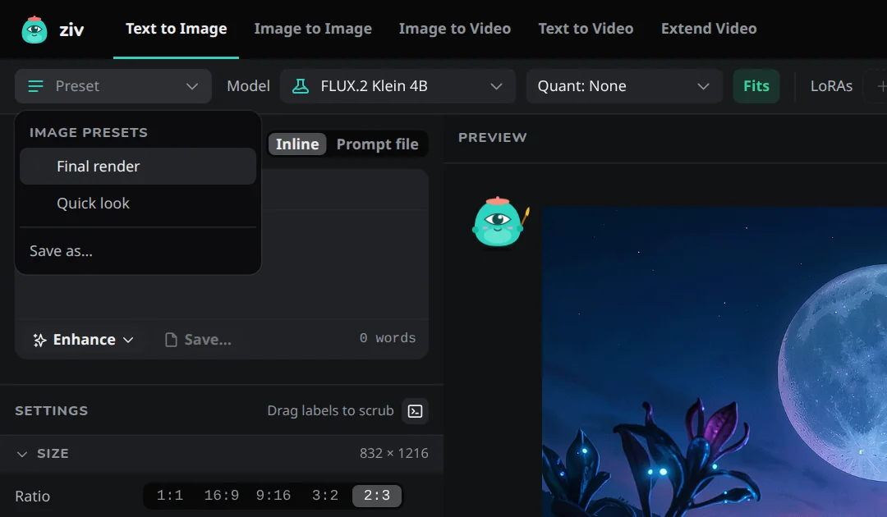
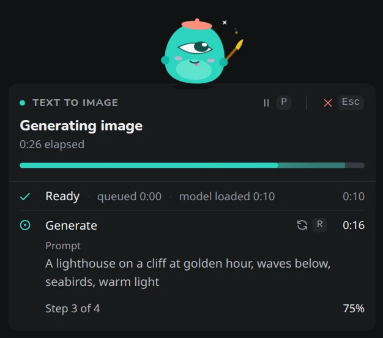

# Workspace

The Workspace is where you make things. Pick a workflow in the top bar, write a prompt under *Compose*, adjust *Settings*, and press **Generate**.

## Model and LoRAs

The top of the sidebar picks the **Model** for the current workflow, its quantization (**Quant**) and its **LoRAs**.

Each model shows whether it is downloaded and a memory badge:

| Badge | Means |
|---|---|
| **Fits** | The model fits comfortably. |
| **Tight** | It runs, but your computer may slow down while it works. |
| **Too large** | Expect heavy swapping or an out-of-memory error. Try a lower quant. |

The badge follows the quant you pick, so you can see whether `q8` or `q4` brings a large model within reach. Hover it for the estimate. See [Memory](../concepts/memory.md) for how it's worked out.

A model that isn't downloaded yet shows *not downloaded*, and downloads by itself when a job first needs it. While it downloads from the [Models](models.md) page, the picker shows its progress, for example *Downloading 42%*.

The **Add LoRA** menu lists the LoRAs made for the selected model first, with the ones you used with it recently on top, and folds the rest under **Other models (n)**. LoRAs are remembered per model family, and per size for FLUX.2 Klein (4B and 9B keep separate LoRAs): switch to another family and you get the LoRAs you last used with it. See [LoRAs](../concepts/loras.md).

## Presets

A **preset** saves your whole setup under a name, so you can bring it back in one step. The **Preset** control is the first item of the Workspace toolbar, before the model.

{ width="540" }

- **What it keeps:** the model, quant, LoRAs and their weights, size, number of runs, steps, guidance, image strength, scheduler, post-processing and upscale settings including review. For video: the length, audio, low memory and upscale.
- **What it leaves alone:** the prompt, seed, reference image and workflow.
- **The menu** has **Update** (write the current settings into the preset), **Save as…**, **Rename…** and **Delete**. A dot on the control shows when the form differs from the applied preset.
- Image and video have their own presets; only the ones for the current kind are listed.
- A model or LoRA that is no longer installed is skipped.
- Switching between image and video, **Reset**, starting an extend, and reusing a job's settings deselect the preset. Pick it again afterwards.

Presets are kept as files in `presets` in the [data folder](../concepts/data-folder.md), so they follow you to every browser. The CLI doesn't use them.

## Compose

### Prompt source

**Prompt source** chooses where the prompt comes from:

- **Inline**: the prompt you type in the box.
- **Prompt file**: prompts from a YAML file on the machine running the server.

With a prompt file, *Compose* summarizes the prompts you chose. Click **Prompts…** to open the chooser, where you filter prompts, select whole sets with **All** and **None**, and confirm with **Use N prompts**. **Edit** opens the file on the [Prompts](prompts.md) page. See [Prompts and prompt files](../concepts/prompts.md).

### The prompt box

The box has two tabs:

- **Prompt** (**Your text** for video) is what you wrote.
- **Enhanced** is the [prompt enhancer](../concepts/prompt-enhancer.md)'s rewrite. When it has text, Generate uses it; **Use mine** goes back to your text.

The tools row under the box has:

- ✨ **Enhance**: rewrite the prompt now, or with **Enhance each image when generating**, rewrite every image's prompt as the job runs. See [Prompt enhancer](../concepts/prompt-enhancer.md#in-the-web-ui).
- **Save…**: append the prompt to a prompt file. See [Save a Workspace prompt](prompts.md#save-a-workspace-prompt).

For video, *Compose* has a **Scene** box above the **Action** box. See [Scene and action](../concepts/video.md#scene-and-action).

### First and last frame

Image to Video shows two slots under **Reference image**: **First frame** and an optional **Last frame**. Pick the last frame the same ways as the first: browse the server, upload from your device, drop an image on the slot, type a path, or choose **Use as reference** → **For last frame (img2vid)** on an image. See [First and last frame](../concepts/video.md#first-and-last-frame).

A **Negative prompt** box appears for models that use one. Ideogram 4 adds a **Prompt (JSON)** mode for a structured caption.

## Settings

*Settings* holds everything else, grouped:

| Group | Has |
|---|---|
| **Size** | **Ratio**, **Resolution**, or a custom **W × H**; **Duration (s)** for video |
| **Sampling** | **Steps**, **Guidance**, **Scheduler**, **Seed**, **Batch size** |
| **Reference image** | The image for Image to Image or Image to Video, and **Img strength**. For video, a **First frame** and an optional **Last frame** |
| **Upscale** | The factor, **Denoise**, and **Review** before upscaling |
| **Post-processing** | **Sharpen**, **Contrast** and **Saturation** (images) |
| **Video** | **Audio**, **Low memory** |

Groups and rows only show when the model and workflow use them.

- **Change a number** by typing it, or by dragging its label sideways. On a touch screen, numbers have − and + buttons instead (hold to repeat).
- **Put one setting back** with the reset mark next to it. **Reset** in the *Settings* header puts all settings back to the model's defaults, and keeps the model, LoRAs, quant and prompt.
- **Seed** is random for every run unless you type one. The dice button picks a new one.

What each setting does is in [Images](../concepts/images.md), [Video](../concepts/video.md) and [Upscaling](../concepts/upscaling.md).

### Settings are remembered

Your settings stay in the browser between visits, as long as the Web UI starts on the same port.

When you choose another model, the settings you changed are kept and the rest take the new model's defaults. A size the new model doesn't offer becomes its largest preset, and a custom size is scaled to fit its limits, keeping its shape. Changing the quant changes nothing else.

**Reset**, **Reuse settings**, **Load settings** and **Extend** apply the model's defaults instead, and use exactly the LoRAs the source was made with.

### Copy as a command

The terminal button in the *Settings* header copies a `ziv image` or `ziv video` command with the current model, prompt, LoRAs and settings, writing to the Web UI's output folder. Paste it in a terminal to run the same job from the [CLI](../cli/index.md).

!!! note "When the command differs"
    The CLI has no inline negative prompt, and runs every prompt in a prompt file rather than only the ones you selected. A notice says when the copied command would do something different. An uploaded reference image is named by its file name: replace it with the file's path.

### Paths on the server

Fields that take a path on the server's machine (prompt files, the output folder, checkpoints, LoRAs, reference images, source videos) have a folder button. It opens a file browser inside the Web UI, so it works the same on every system and from a phone.

- It opens at the field's current path or the matching folder, and lists only the files the field accepts. **Show all** lists the rest; **Hidden files** shows names that start with a dot.
- Your last five choices are under **Recent**.
- Click the path bar or press ++slash++ to type a path.

Typing in the field itself suggests matching folders and files: ++tab++ takes the first, the arrow keys and ++enter++ pick another, and ++down++ in an empty field suggests recent paths and the usual folders.

The reference image also has an upload button for a picture on the device you're browsing from.

## Generate

Press **Generate**, or ++ctrl+enter++ (++cmd+enter++ on a Mac). ++ctrl+shift+enter++ generates with a new seed, even when the seed is locked.

If the job can't start with the current settings, for example Image to Image without a reference image, the reason shows above the button. It goes away when you change a setting.

### While a job runs

{ width="420" }

The **live preview** shows the current image taking shape after every step ([Live preview](../concepts/images.md#live-preview)), so you can skip a bad one early. It has the image's own shape, a custom size included. It is a preview only and never saved.

The **job card** beside it shows the progress, the time left and each phase with its timing. When a model isn't downloaded yet, the load step shows the download first, with its size, speed and time left.

| Control | Does | Key |
|---|---|---|
| **Pause** | Waits after the current image, until you resume | ++p++ |
| **Cancel** | Stops the job at its next step | ++esc++ ++esc++ |
| **Skip** | Stops the current image and moves to the next | ++n++ |
| **Repeat** | Makes the current image again with a new seed, after it finishes | ++r++ |

Video jobs offer **Cancel** only. With [review before upscaling](../concepts/upscaling.md#review-before-upscaling) on, the card also offers **Approve** (++y++) and **Discard** (++n++).

!!! note "Cancelling during a download"
    Cancel stops a download at once. Finished files are kept and the file in progress starts over next time. A job that only waits for a download started from the Models page is cancelled, and the download keeps going.

If a job fails, the card says why. The [Job log](job-log.md) keeps the reason.

### The queue

You can keep working while a job runs. Change the prompt or settings and press **Add to queue** (the Generate button while jobs are active).

- Queued jobs run one after another, in order, each with the settings it had when you added it.
- They are listed under the job card as **Up next**, each with its prompt, size and steps, such as `1600x896 · 8 steps`. Each can be removed, or its settings copied back into the form with **Load settings**.
- **Clear queue** removes them all after asking. It never stops the running job.
- If a job fails, the next one starts anyway.

The queue is shared by every open tab, and lives in the server's memory: stopping the server clears it.

While jobs are running or queued, the manual **Enhance prompt** button is unavailable, because the enhancer needs the same memory. Enhancing inside each job still works.

A job keeps running when you close or reload the tab. Reopen the Workspace and it reconnects.

## The preview and the Gallery strip

Finished images and videos appear in the Gallery strip, newest first. It is the same list as the [Gallery](gallery.md) page, so a new output or a delete shows in both. Scroll to the end and older ones load in. Click one to open the [viewer](gallery.md#the-viewer); **Show all** opens the Gallery page.

- Press ++left++ and ++right++ (or use the arrows over the preview, or swipe sideways with two fingers on a trackpad) to step through earlier outputs in the preview. **Latest** goes back to the newest.
- The **«** button next to *Compose* folds the sidebar into a narrow strip, giving the preview more room. The choice is remembered.

## Model-specific controls

Some models change what the Workspace offers:

- **Ideogram 4 Instant** adds a JSON caption mode and a **First sigma** setting. It has no reference image or upscale, and its width and height are limited to 256–2048 in steps of 16. See [Ideogram 4](../concepts/models.md#ideogram-4-instant).
- **Krea 2** hides **Scheduler**, because it samples with its own schedule.
- **Video** adds **Duration (s)**, **Audio** and **Low memory**.
