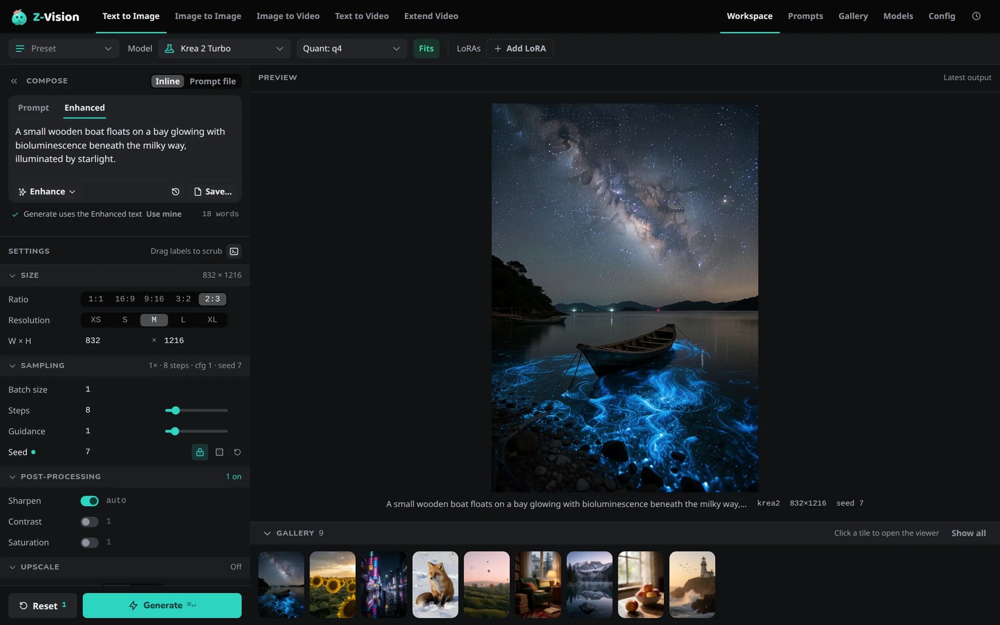
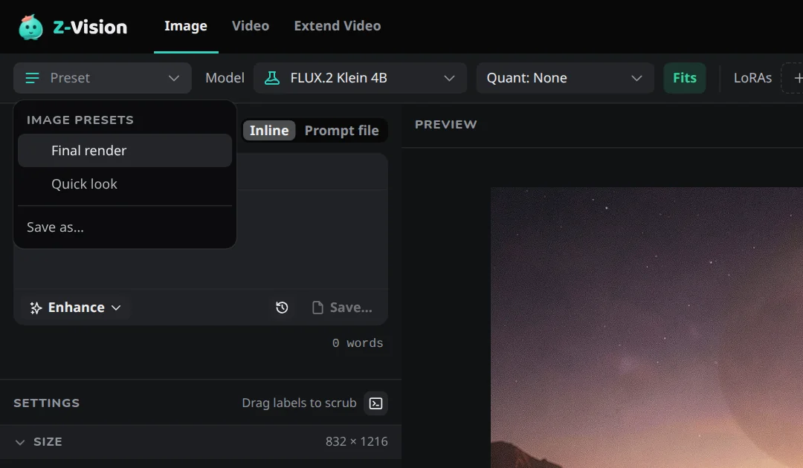
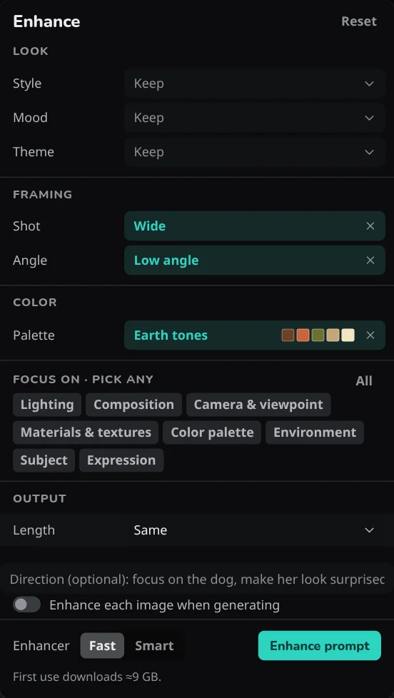
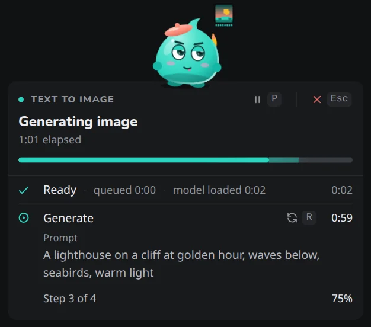

# Workspace

The Workspace is where you make things. Pick **Image**, **Video** or [**Audio**](#the-audio-tab) in the top bar, write a prompt under *Compose*, adjust *Settings*, and press **Generate**. A run starts from an image when you add one in [Images](#images). **Image** and **Video** each keep their own prompt, model, settings and preset, and each comes back as you left it.

**Video** has two kinds, chosen with **Kind** at the start of the toolbar: **New** makes a clip from text or a first frame, and **Extend** continues a clip you already have (see [Extending a video](../concepts/video.md#extending-a-video)). The two share the prompt, model, LoRAs, steps and seed; each keeps its own inputs. **Kind** is hidden on a computer that can't extend.

## Model and LoRAs

The top of the sidebar picks the **Model** for the current tab, its quantization (**Quant**) and its **LoRAs**.

Each model shows whether it is downloaded and a memory badge:

| Badge | Means |
|---|---|
| **Fits** | The model fits comfortably. |
| **Tight** | It runs, but your computer may slow down while it works. |
| **Too large** | Expect heavy swapping or an out-of-memory error. Try a lower quant. |

The badge follows the quant you pick, so you can see whether `q8` or `q4` brings a large model within reach. Hover it for the estimate. See [Memory](../concepts/memory.md) for how it's worked out.

Every built-in model has an **ⓘ** beside the picker. Hover or press it to read the model's licence (see [Licences](../concepts/models.md#licences)). A model of your own has none.

A model that isn't downloaded yet shows *not downloaded*. When a job would download it, **Generate** first asks: the dialog lists what will download (the model, the prompt enhancer, the background removal models) with its size, the free space and its terms. **Download** starts the job and the download; **Cancel** queues nothing. A model that is already downloading isn't asked about again, and its picker shows its progress.

The **Add LoRA** menu lists the LoRAs made for the selected model first, with the ones you used with it recently on top, and folds the rest under **Other models (n)**. Its last item, **Discover LoRAs…**, opens [Discover LoRAs](#discover-loras). LoRAs are remembered per model family, and per size for FLUX.2 Klein (4B and 9B keep separate LoRAs): switch to another family and you get the LoRAs you last used with it. See [LoRAs](../concepts/loras.md).

### Discover LoRAs

**Discover LoRAs…** is the last item of **Add LoRA** (on a phone, in the LoRAs menu under **All**), and **Add LoRA** opens it straight away when you have no LoRAs yet. What Curated and Hugging Face are is in [LoRAs](../concepts/loras.md#discover-loras).

- The **Installed**, **Curated** and **Hugging Face** tabs each have a search. The first time you open **Hugging Face**, you confirm that you want its results.
- Pick a LoRA to see its details. **Download** gets the file, and **Use in LoRAs** adds it to your chips, downloading it first if needed.

While a LoRA downloads, **Generate** waits for it. If the download fails, the chip turns red and **Retry** appears above Generate.

## Presets

A **preset** saves your whole setup under a name, so you can bring it back in one step. The **Preset** control is the first item of the Workspace toolbar, before the model.

{ width="540" }

- **What it keeps:** the model, quant, LoRAs and their weights, size, number of runs, steps, guidance, image strength, scheduler, post-processing and upscale settings including review. For video: the length, audio, low memory and upscale.
- **What it leaves alone:** the prompt, seed and images.
- **The menu** has **Update** (write the current settings into the preset), **Save as…**, **Rename…** and **Delete**. A dot on the control shows when the form differs from the applied preset.
- Image and video have their own presets; only the ones for the current kind are listed.
- A model or LoRA that isn't installed is skipped.
- **Reset**, starting an extend, and reusing a job's settings deselect the preset. Pick it again afterwards. Switching between Image and Video leaves each tab's preset as it was.

Presets are kept as files in `presets` in the [data folder](../concepts/data-folder.md), so they follow you to every browser. The CLI doesn't use them.

## Compose

### Prompt source

**Prompt source** chooses where the prompt comes from:

- **Inline**: the prompt you type in the box.
- **Prompt file**: prompts from a YAML file on the machine running the server.

With a prompt file, *Compose* summarizes the prompts you chose. Click **Prompts…** to open the chooser, where you filter prompts, select whole sets with **All** and **None**, and confirm with **Use N prompts**. **Edit** opens the file on the [Prompts](prompts.md) page. See [Prompts and prompt files](../concepts/prompts.md).

### The prompt box

The box has a header, the text and a tools row. Messages from the last run appear in one line under the box.

**The header** says which text you are looking at, and what Generate sends:

- **Prompt** is what you wrote.
- **Enhanced** is the [prompt enhancer](../concepts/prompt-enhancer.md)'s rewrite. When it has text, Generate uses it.

A mark on the **Enhanced** tab tells you when Generate sends it: a dot while you look at your own text, ⚠ when it is out of date, and a small spinner while Enhance runs. With the **Enhanced** tab open, **✕** after the tab scratches the Enhanced text, so Generate sends your text again, and while Enhance runs a stop ring takes its place. At the right end, `‹ 2 of 3 ›` steps through the last five versions of the Enhanced text. No mark anywhere means Generate sends your own text. What the marks mean, and how versions work, is in [Prompt enhancer](../concepts/prompt-enhancer.md#in-the-web-ui).

With the JSON box on, or with **Enhance each image when generating** on, the header is a single **Prompt** heading with no tabs and no marks: the text Generate sends is the one in the box (or, for each image, your prompt, rewritten as the job runs).

**The tools row** under the box holds what you can do with the text. With the JSON box on, **Enhance** and **Save** are hidden:

- ✨ **Enhance**: rewrite the prompt now, or with **Enhance each image when generating**, rewrite every image's prompt as the job runs. When the Enhanced text is out of date the icon is ⚠ and the panel opens on **Enhance again**, with the reason beside it; with **Enhance each image when generating** on there is no ⚠. See [Prompt enhancer](../concepts/prompt-enhancer.md#in-the-web-ui).
- **{ }** (*JSON caption*, Ideogram 4): swap the prompt for a structured caption. It is teal while on.
- 🗑 **Clear**: empty the box. It clears your text, the Enhanced text and its versions (with JSON on, the JSON prompt), and a video's Scene and Action together. It shows only while the box holds something, and the line under the box then reads **Cleared. Undo** until your next edit or run there. There is no confirmation.
- 🏷 **Triggers**: put a trigger word of a LoRA in use into the prompt. The number beside the tag counts the words the prompt does not hold yet. See [LoRAs](../concepts/loras.md).
- 🕘 **Recent prompts**: bring back a prompt you generated before. See below.
- **Save**: append the prompt to a prompt file. See [Save a Workspace prompt](prompts.md#save-a-workspace-prompt). It is a button with the file icon and the name *Save to prompt file…*.

{ width="420" }

For video, *Compose* has a **Scene** box above the **Action** box. See [Scene and action](../concepts/video.md#scene-and-action).

### Recent prompts

The 🕘 button in the tools row lists the prompts you generated in the current mode, newest first: image prompts in **Image**, video prompts (a scene and an action together) in **Video**, whichever kind. Each row shows up to two lines of the prompt (or of the scene), how long ago, and a **{ } JSON** badge for a JSON caption. Hover a row to read the whole prompt. A line below shows a video's scene, or an image prompt's **Negative:** prompt when it has one. Type in the filter to search all of that mode's prompts, not only the ones shown. The list shows up to 50 matches.

- **Pick a row** to bring the prompt back: the prompt, a video's scene and the negative prompt go into their boxes, and any Enhanced text and its versions are dropped. A JSON caption turns on the **{ }** JSON caption and fills its box. JSON rows are greyed out, with the reason, on a model that takes no JSON captions. Settings, model and tab don't change.
- **From the keyboard:** press ++alt+up++ in an empty prompt to open the list with the filter ready. ++up++ and ++down++ move, ++enter++ picks and ++esc++ closes and puts the cursor back in the prompt box (or on the button, if you opened the list with it).
- **Clear recents** at the bottom of the list removes the prompts of the list you are in, after asking. Every other list stays.

Recents are kept in the app database on the server, not in the browser, so they are the same on every device you open the Web UI from. Prompts that come from a prompt file are not recorded, and neither are refused or blank submits.

A **Negative prompt** box appears for models that use one. Ideogram 4 adds a **Prompt (JSON)** mode for a structured caption.

## Settings

*Settings* holds everything else, grouped:

| Group | Has |
|---|---|
| **Size** | **Ratio**, **Resolution**, or a custom **W × H**; **Duration (s)** for video |
| **Sampling** | **Steps**, **Guidance**, **Scheduler**, **Seed**, **Batch size** |
| **Images** | In Image, the **Start image** with its **Strength**, and [references](#references) (FLUX.2 Klein). In Video, a **First frame** and an optional **Last frame**. See [Images](#images) |
| **Audio track** | In Video, either kind, an audio file the clip follows, with **Start at**. See [Audio track](#audio-track) |
| **Upscale** | The factor, **Denoise**, and **Review** before upscaling |
| **Post-processing** | **Sharpen**, **Contrast**, **Saturation** and **Transparent** (images) |
| **Video** | **Audio**, **Low memory** |

Groups and rows only show when the model and tab use them.

- **Change a number** by typing it, or by dragging its label sideways. On a touch screen, numbers have − and + buttons instead (hold to repeat).
- **Put one setting back** with the reset mark next to it. **Reset** in the *Settings* header puts the open tab [back to its defaults](#reset). The number beside it counts the settings that differ from their defaults, and a phone shows the same number on its *All* sheet.
- **Seed** is random for every run unless you type one. The dice button picks a new one.

What each setting does is in [Images](../concepts/images.md), [Video](../concepts/video.md) and [Upscaling](../concepts/upscaling.md).

### Transparent background

**Transparent** in **Post-processing** switches on [Transparent background](../concepts/images.md#transparent-background). The **Non-commercial** button beside it opens the cut-out models' terms.

On a phone, the switch is in the **Post-processing** section of **All**.

### Images

The **Images** section holds every image the run uses, in **Image** and in **Video**. What an image is for, and how it changes the result, is in [Images](../concepts/images.md) and [Video](../concepts/video.md#first-and-last-frame).

With no image, **Generate** makes the picture or clip from the prompt. With a start image or a first frame, it starts from that image. The [Gallery](gallery.md) and the [Job log](job-log.md) label each job by what ran, such as *Image to image* or *Text to video*.

Folded, the header's summary says what **Generate** will use: in Image *None*, *pond.png*, *pond.png · 2 references* or *2 references*; in Video *None*, *dawn.png* or *dawn.png → dusk.png*. It turns red when an image the run uses is missing.

**In Image**

- **Start image:** an *Image* row with a thumbnail, the name, buttons to browse the server and to upload from your device, and × while an image is set. The empty row reads *Browse or drop*: drop an image on it to set it.
- **Strength** is a row under the start image's, shown only while a start image is set.
- **[References](#references)** follow, for models that take them (FLUX.2 Klein only).

**In Video**

- **First frame:** an *Image* row, as for a start image.
- **Last frame:** the same row, marked *Optional*, to end the clip on a second image.
- **Last frame without a first frame:** if you remove the first frame, the last frame stays, greyed, with *Not used without a first frame*. It is used again when you add a first frame.

**Where images stay**

- An image stays until you press its × or **Reset**, also after a reload.
- **Image** and **Video** each keep their own images; switching tabs, kinds or models clears none of them.
- **Reuse settings** and **Load settings** replace the open tab's images with the ones the job used.

**Images a model can't use**

An image the model can't use is hidden: a start image on Ideogram 4, references on a model without them, a first frame on a video model that can't start from an image, a last frame on a video model without one. It is not shown, not sent and not counted in the summary, but it stays in the draft and comes back on a model that can use it. When the model can use no image at all, the **Images** section is hidden.

**Missing images**

An image that **Generate** would use but can't find shows a mark in its row and blocks **Generate**, with the reason above the button, such as *The start image is missing.* A file on the server that has moved or been deleted says *This image has moved or been deleted. Choose it again or remove it.* An upload whose file the browser can't read back says *Choose this image again.* Choose the file again or remove the image. A last frame blocks only while there is a first frame.

**On a phone,** one **Images** chip in the strip opens the same groups in a popover. See [Other devices](devices.md#images-on-a-phone).

#### References

When the model takes [references](../concepts/images.md#references), the **Images** section has a **References** group of up to four rows, each like the start image's row. The empty row after them, *Add reference*, adds the next one. You can also drop several images on it at once, or drop one on a filled row to replace it. On a phone, **Replace** on a row whose image is gone swaps the next image you choose into that row and keeps its number.

- **Number:** a row's position is its number in the prompt: *Reference 1* is "image 1". Removing a row renumbers the rest, and a line under the rows reminds you to refer to them that way.
- **Fewer references than you set:** the Video tab uses none, and a model that takes fewer shows and sends the first ones. The rest come back with a model that takes more.
- **With a start image,** both apply. See [References with a start image](../concepts/images.md#references-with-a-start-image) for what to expect.
- **Add one from an image you made:** **Use as** → **Reference** in the [Gallery or viewer](gallery.md#use-as) adds it as the next number and keeps the prompt.

### Audio track

The **Audio track** section comes after **Images** in **Video**, and after **Source video** in the **Extend** kind. Give it a file by path, **Browse**, upload or drop (WAV, MP3, M4A, FLAC or OGG), and set **Start at** in seconds. The track's length shows beside its name to help you choose **Start at**. What the track does is in [Audio track](../concepts/video.md#audio-track).

In the **Extend** kind, choosing a source made from a track fills in that track from where its sound ended; a track you chose yourself stays when you change the source. [Reset](#reset) clears the track, except one the source filled in.

A server file that can't be read is refused at **Generate** with *Can't read the audio track*. An upload lost on reload blocks **Generate** with *Choose the audio track again.* On a phone, the **Track** chip opens the same rows in a popover.

### Settings are remembered

Your settings stay in the browser between visits, as long as the Web UI starts on the same port.

When you choose another model, the settings you changed are kept and the rest take the new model's defaults. A size the new model doesn't offer becomes its largest preset.

**Reuse settings** and **Load settings** apply a take's settings exactly: what the take did not record takes its default instead of what the form held. They replace the open tab's settings, images, prompts, LoRAs, quant and *Enhance* options and leave the other tabs alone. **Use as** changes only what it names.

### Reset

**Reset** in the *Settings* header puts the open tab back to its defaults: its settings, images, audio track and *Enhance* options, and the applied preset is deselected. On Audio it puts back the tempo, key, delivery, sound type, length, the voice, the *Enhance* options, **Batch size** and **Seed**. It keeps the model, LoRAs and quant, the prompts and the Extend source, and it never touches another tab. **Batch size** and **Seed** are shared by every tab, so each Reset puts them back.

### Copy as a command

The terminal button in the *Settings* header copies a `ziv image`, `ziv video` or `ziv audio` command with the current model, prompt, LoRAs and settings, writing to the Web UI's output folder. Paste it in a terminal to run the same job from the [CLI](../cli/index.md).

!!! note "When the command differs"
    The CLI has no inline negative prompt, and runs every prompt in a prompt file rather than only the ones you selected. A notice says when the copied command would do something different. An uploaded start image or reference is named by its file name: replace it with the file's path.

### Paths on the server

Fields that take a path on the server's machine (prompt files, the output folder, checkpoints, LoRAs, images, audio tracks, source videos) have a folder button. It opens a file browser inside the Web UI, so it works the same on every system and from a phone.

- It opens at the field's current path or the matching folder, and lists only the files the field accepts. **Show all** lists the rest; **Hidden files** shows names that start with a dot.
- Your last five choices are under **Recent**.
- Click the path bar or press ++slash++ to type a path.
- Click **Name**, **Size** or **Modified** to sort, and again to reverse. The order is remembered, starting with newest first.
- For images, audio tracks and source videos it shows thumbnails, can switch to a grid, and has a preview (**Preview** or ++alt+p++) that plays audio and video when you press play. Once chosen, the slot shows the file too.

Typing in a path field suggests matching folders and files: ++tab++ takes the first, the arrow keys and ++enter++ pick another, and ++down++ in an empty field suggests recent paths and the usual folders.

## The Audio tab

**Audio** is the last tab in the top bar. It makes music, speech and sound; what each kind is, the models and the limits are in [Audio](../concepts/audio.md). The tab is hidden on a machine that can't run an audio model.

To make a take, pick the **Kind** (**Music**, **Speech** or **Sound**) and the **Model** in the toolbar, write the **Style**, the **Text** or the **Prompt** in Compose, and press **Generate**. The helpers below are optional. A model that isn't downloaded yet is asked for when you press **Generate**, as for [images](#model-and-loras). The kind decides what *Compose* and *Settings* show; presets, **Quant** and LoRAs aren't used.

| Kind | Compose | Settings |
|---|---|---|
| **Music** | [**Describe it**](#describe-it), then **Style** (required), with an **Enhanced** tab, above **Lyrics**; a model without lyrics has only the Style | The [Music](#music) section, then **Batch size** and **Seed** |
| **Speech** | [**Describe it**](#describe-it), then **Text**, with a **Written** tab, an [Insert](#insert-into-the-text) menu, a [Script helper](#script-helper) and a count of the characters and the time it takes to read | **Voice** and [Delivery](#delivery), then **Batch size** and **Seed** |
| **Sound** | **Prompt**, what you hear, with an **Enhanced** tab | The [Sound](#sound) section, then **Batch size** and **Seed** |

Every box has a 🗑 **Clear** first in the right of its tools row, as in [the prompt box](#the-prompt-box): it empties your text, the Enhanced (Written) text and its versions, or for Lyrics the whole song and its versions, and **Undo** in the line under the box brings it all back until your next edit or run there.

See [Music](../concepts/audio.md#music), [Speech](../concepts/audio.md#speech) and [Sound](../concepts/audio.md#sound) for what each kind does. The Style and Prompt boxes enhance as in [Music Enhance](#music-enhance) and [Sound Enhance](#sound-enhance); the Lyrics and the Speech text have the [Lyrics helper](#lyrics-helper) and the [Script helper](#script-helper). There is no JSON mode or negative prompt.

### Describe it

**Describe it** is a box at the top of Compose for Music and Speech, shown wherever the prompt enhancer is set up. Write the idea in it (*a sad folk song about leaving the coast*) and press **Fill in**, or <kbd>Ctrl</kbd>+<kbd>Enter</kbd> (<kbd>⌘</kbd>+<kbd>Enter</kbd>) in the box. What it writes and keeps is in [Describe it and Fill in](../concepts/prompt-enhancer.md#describe-it-and-fill-in).

- **Fill in** writes only the fields that are empty. A line under the box says which, and the button is off with the reason in that line when there is nothing to write.
- **Fast** or **Smart** beside **Fill in** is the enhancer it uses. It is remembered apart from the one in Enhance and the helpers, and a helper's **Fill in from Describe it** uses it. The line under the box adds the first-use download when the enhancer is not on this machine yet.
- 🗑 **Clear** empties the idea, in the open box and on the folded line. What Fill in wrote stays, with its **Undo fill**.
- **✦** marks the Tempo, Key and Vibe it wrote until you edit them. **Fill in again** rewrites only the empty and still marked fields.
- **Undo fill** puts back what the fill replaced, for the fields still marked. The Style it wrote lands in your own **Style** tab, like Speech's Text.
- The box folds to one line after a fill, and starts folded when you begin with your own lyrics or text.
- The lyrics helper on a song with no words and the Script helper on an empty script offer **Fill in from Describe it**.

### Song blocks

The Lyrics box shows a song as one block per section (**Verse**, **Chorus**, **Pre-Chorus**…), each with its words in a box. A section with no words is an instrumental section, so a list of empty blocks makes an [instrumental](../concepts/audio.md#music) of those sections.

- **Add** at the foot adds a section: **Verse**, **Chorus**, **Bridge** and **Outro** directly, and **More** for the whole list.
- The **⋯** button of a block opens **Improve this section…** (or **Write**, on a section with no words) when the prompt enhancer is set up, then **Move up**, **Move down**, **Duplicate**, **Add a section below** and **Remove**. **Remove** on a block with words offers **Undo** until the next change.
- The block's name opens the list of section names, and **Other name…** types one of your own.
- **Edit as text** shows the whole lyrics as one text with its `[section]` tags, and back. Pasted or reused lyrics show exactly as written.

### Lyrics helper

**Improve lyrics** in the Lyrics tools row opens a popover beside the button (a sheet on a tablet or phone) for the whole song. Each block's **Improve** button, or **Write** on a section with no words, opens it for that section. What it writes and keeps is in [Lyrics helper](../concepts/prompt-enhancer.md#lyrics-helper).

- **Improve lyrics** offers **Tighten**, **Fit the sections**, **Smooth rhymes** and **Simpler words**, pick any, and a **Direction** such as *make it more hopeful*, with the **Fast** or **Smart** enhancer. **Tighten** is picked when the panel opens; clear every pick for a general polish.
- **Improve a section** has the same choices without **Fit the sections**.
- **Write** has only the **Direction**. It fills the section to fit the rest of the song.

Each result is a version of the lyrics: ‹ **2 of 3** › in the Lyrics head steps through up to five, yours first, and a ✦ after **Lyrics** marks a version a helper wrote. Typing in a version makes it yours. Generate uses the lyrics shown.

### Music

The **Music** section comes first in Music's *Settings*. Its header shows what is set: *Auto*, or *92 BPM · A minor*.

- **Tempo** is a number from 40 to 220 beats per minute. Empty reads **Auto**, where the model picks.
- **Key** opens a list: **Auto**, then the twelve major keys and the twelve minor keys.
- **Length (s)** is only there for a model that sets its own length, Stable Audio: 1 to 380 seconds, 30 to begin with.

A changed row has a dot, and its reset puts it back to Auto (or to 30 seconds). What each setting does is in [Tempo and Key](../concepts/audio.md#tempo-and-key).

**Stable Audio 3 Medium** is offered under **Music** next to YuE2 and under **Sound**. On it, Music has no **Lyrics** box and the section adds **Length (s)**. See [Stable Audio under Music](../concepts/audio.md#stable-audio-under-music).

### Sound

The **Sound** section comes first in Sound's *Settings*. Its header shows the type and the length the take will have: *Ambience · ≈ 12 s*.

- **Type** is **Auto**, **Ambience**, **Effect** or **One-shot**.
- **Length (s)** is empty on Auto, and the field shows the number Auto will use. Typing a number from 1 to 380 locks it, whatever the type, and emptying the field goes back to Auto.

A changed row has a dot, and its reset puts it back to Auto. What each type does is in [Sound](../concepts/audio.md#sound).

### Sound Enhance

**Enhance** under the Sound prompt rewrites it into the shape Stable Audio follows; what it writes is in [Audio](../concepts/prompt-enhancer.md#audio). The header, marks and versions work as in [the prompt box](#the-prompt-box). The panel opens as a popover on a computer and as a sheet on a tablet or phone.

- **Space**, **Distance**, **Over time** and **Movement** each start on **Keep**. **Direction** takes your own words, such as *keep the thunder far off*. **Reset** puts every choice back to Keep and clears the direction.
- **Enhancer** (Fast or Smart) sits beside **Enhance prompt**, which starts the rewrite. The **Type** and **Length** go along.

**Reuse settings**, **Retry** and **Load settings** of an enhanced sound put your text in **Prompt** and the rewrite in **Enhanced**.

### Music Enhance

**Enhance** under the Style rewrites it for the open model, as a line of descriptors for YuE2 or a sentence for Stable Audio 3; what it writes is in [Audio](../concepts/prompt-enhancer.md#audio). It never touches Lyrics. It works as [Sound Enhance](#sound-enhance) does, with these options:

- **Genre** (grouped), **Mood** and **Production** each start on **Keep**; **Instruments** and **Without** are pick-any chips. **Direction** takes your own words, such as *keep the guitar fingerpicked*.
- **Singer** is there only when the song has words to sing.
- Your lyrics' first lines, whether the song is instrumental, and any Tempo and Key go along; Length never does.

**Reuse settings**, **Retry** and **Load settings** of an enhanced song put your style in **Style** and the rewrite in **Enhanced**.

### Insert into the text

**Insert** in the Speech tools row (or <kbd>Alt</kbd>+<kbd>Enter</kbd> in the text) opens a menu that puts something readable into the text at the caret. A selection is replaced. While the **Written** tab is shown, it edits the Written text. Under the box, the count reads *1,180 / 10,000 characters · about 1:24*.

- **Pause** puts `…` and **Laugh** puts `haha`.
- **Delivery from here** offers the emotions in four groups, **Whisper**, **Shout** and **As set**. Your pick goes in as a `[mark]` at the start of the sentence the caret is in; a mark that already opens the sentence is replaced. It is hidden while the voice follows a recording.

What a mark does, and the pause and the laugh, are in [Marks](../concepts/audio.md#marks) and [Pauses and laughs](../concepts/audio.md#pauses-and-laughs).

### Script helper

**Script helper** in the Speech tools row opens a popover beside the button (a sheet on a tablet or a phone). It always starts from your **Text**. What it writes and keeps is in [Script helper](../concepts/prompt-enhancer.md#script-helper).

- **Fit to time** and **Add delivery** are checkboxes, any of them. The run button names the picks. With both, one run fits the Text and then adds delivery, as one Written version with one **Stop**. **Add delivery** is left out while the voice follows a recording.
- **Fit to** takes a number of seconds (3 to 600) and shows while **Fit to time** is picked.
- The **Fast** or **Smart** enhancer is chosen beside the run button.

A result lands in the **Written** tab beside your **Text**; ‹ **2 of 3** › steps through up to five. Generate sends the Written text. You can edit it by hand.

### Voice

**Voice** is the first group in Speech's *Settings*. Its select lists the model's nine built-in voices, each with its language (*Ryan · English*), and **From a recording**. Ryan is the default.

To follow a recording, choose **From a recording**: add a file of 3 to 30 seconds (Browse, upload or drop), type **What it says**, and tick *This is my voice, or I have the speaker's permission to clone it.* The tick is asked again whenever the voice changes. The cloning files download the first time you generate with a recording. See [Voices](../concepts/audio.md#voices).

### Delivery

**Delivery** comes after Voice in Speech's *Settings* and sets how a built-in voice says the text. Pick one of the six **Vibe** tiles to fill the five rows below it, and edit any row:

- **Emotion**: **Neutral**, or one of the emotions in four groups.
- **Manner**: **Natural**, **Whisper** or **Shout**.
- **Pace**: a slider from *Very slow* to *Very fast*.
- **Pitch** and **Expressiveness**: **Low**, **Normal** or **High**.

A changed row has a dot and its own reset; the reset beside **Vibe** puts all five back. With **From a recording** chosen in Voice, the section only says that a cloned voice reads as recorded. What each setting does and the Vibes' values are in [Delivery](../concepts/audio.md#delivery).

### While a take is made

The job card counts takes (*Take 1 of 2*) and shows the stage the model is in. The preview strip shows the take forming and settles into its waveform when it is ready. **Pause**, **Skip**, **Repeat** and **Cancel** work as for [images](#while-a-job-runs).

### The result

The preview shows the finished take as a player. Click or drag the waveform to seek; nothing plays by itself. **Reuse settings** and the **⋯** menu sit in the corner of the panel, and a take that reached YuE2's limit carries **Cut at 6:00**. Takes appear in the Gallery strip as audio tiles; see [Audio in the Gallery](gallery.md#audio). On a phone, see [Audio on a phone](devices.md#audio-on-a-phone).

## Generate

Press **Generate**, or ++ctrl+enter++ (++cmd+enter++ on a Mac). ++ctrl+shift+enter++ generates with a new seed, even when the seed is locked.

If the job can't start with the current settings, for example because the start image is missing, the reason shows above the button. It goes away when you change a setting.

### While a job runs

{ width="420" }

The **live preview** shows the current image taking shape after every step ([Live preview](../concepts/images.md#live-preview)), so you can skip a bad one early. It has the image's own shape, a custom size included. It is a preview only and never saved.

The **job card** beside it shows the progress, the time left and each phase with its timing. When a model isn't downloaded yet, the load step shows the download first, with its size, speed and time left. Jobs that are already in the queue don't ask; they download when their turn comes.

| Control | Does | Key |
|---|---|---|
| **Pause** | Waits after the current image or video, until you resume | ++p++ |
| **Cancel** | Stops the job at its next step | ++esc++ ++esc++ |
| **Skip** | Stops the current image or video and moves to the next | ++n++ |
| **Repeat** | Makes the current image or video again with a new seed, after it finishes | ++r++ |

Video jobs have the same controls; see [Controls while a video runs](../concepts/video.md#controls-while-a-video-runs). With [review before upscaling](../concepts/upscaling.md#review-before-upscaling) on, the card also offers **Approve** (++y++) and **Discard** (++n++).

!!! note "Cancelling during a download"
    Cancel stops a download at once. Finished files are kept and the file in progress starts over next time. A job that only waits for a download started from the Models page is cancelled, and the download keeps going.

If a job fails, the card says why. The [Job log](job-log.md) keeps the reason.

### The queue

You can keep working while a job runs. Change the prompt or settings and press **Add to queue** (the Generate button while jobs are active).

- Queued jobs run one after another, in order, each with the settings it had when you added it.
- They are listed under the job card as **Up next**, each with its prompt, size and steps, such as `1600x896 · 8 steps`. Each can be removed, or its settings copied back into the form with **Load settings**.
- **Clear queue** removes them all after asking. It never stops the running job.
- If a job fails, the next one starts anyway.

The queue is shared by every open tab, and lives in the server's memory: stopping the server clears it.

While jobs are running or queued, the manual **Enhance prompt** button is unavailable, because the enhancer needs the same memory. Enhancing inside each job still works.

A job keeps running when you close or reload the tab. Reopen the Workspace and it reconnects.

## The preview and the Gallery strip

Finished images and videos appear in the Gallery strip, newest first. It is the same list as the [Gallery](gallery.md) page, so a new output or a delete shows in both. Scroll to the end and older ones load in. Click one to open the [viewer](gallery.md#the-viewer); **Show all** opens the Gallery page.

- Press ++left++ and ++right++ (or use the arrows over the preview, or swipe sideways with two fingers on a trackpad) to step through earlier outputs in the preview. **Latest** goes back to the newest.
- The **«** button next to *Compose* folds the sidebar into a narrow strip, giving the preview more room. The choice is remembered.

## Model-specific controls

Some models change what the Workspace offers:

- **Ideogram 4 Instant** adds a JSON caption mode and a **First sigma** setting. It has no start image or upscale, so the **Images** section is hidden, and its width and height are limited to 256–2048 in steps of 16. See [Ideogram 4](../concepts/models.md#ideogram-4-instant).
- **Video** adds **Duration (s)**, **Audio**, **Low memory** and, on models that follow one, an [**Audio track**](#audio-track).
- **Audio** replaces the prompt box and settings with those of its [kind](#the-audio-tab).
